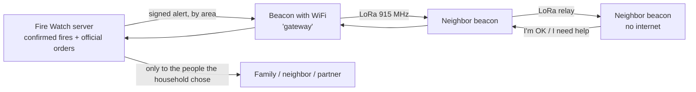

# Home Beacon: build plan (pilot)

Written 2026-11-25. **Status: a plan only. It is not approved to build (decision #27), and nothing here changes the v1
kit.** Background and the problem it solves: `docs/FUTURE.md` → "Option: Fire Watch Home Beacon". Rules for
selling hardware: `docs/PRODUCT_PLAN.md` § 4. First responders: `docs/PRODUCT_PLAN.md` § 6. Prices were checked on the
sellers' own pages on 2026-11-25; anything not checked is marked *estimate*.

## 1. What it is, and what it must never claim
A small box in the home that keeps working when phones and internet don't:
1. **Relays confirmed fire alerts and official evacuation orders** from house to house over LoRa radio (915 MHz).
   One beacon with WiFi, or a solar relay at a school or fire station, feeds the neighborhood.
2. **Sounds a loud alarm and flashes a light** in the home: for people without smartphones, people who are asleep,
   and people who are hard of hearing.
3. **Has two big buttons, "I'm OK" and "I need help",** whose status reaches the people the household chose (§ 8).
4. **Shows status** on its small screen: "Alerts on", battery level, "Last alert 2 h ago".

It must **never** claim or do the following. This wording goes on the box, the screen and the guide:
- **It is not a smoke alarm.** Keep your smoke alarms; this doesn't replace them or have their UL 217 listing.
- **It does not call 911.** "If you need help now, call or text 911."
- **It doesn't replace official alerts or evacuation orders.** "If officials tell you to leave, or you feel unsafe,
  leave right away. Don't wait for this box."
- **It never sounds for one sensor's smoke reading or for a "possible" fire.** Only confirmed alerts and official
  orders set off the alarm (§ 6).

## 2. How it works

Every beacon both **receives and relays**. When cell towers or home internet fail, alerts that reached any beacon in
range keep hopping between houses.

## 3. Parts for one pilot beacon (two-box design: the air sensor stays outside, this box has no PMS)
| # | Part | Qty | Price (1 unit) | Source | Why this one |
|---|---|---|---|---|---|
| 1 | **Heltec WiFi LoRa 32 V3**, 863–928 MHz version (ESP32-S3 + SX1262, screen, battery charger; includes a LoRa antenna and battery plug) | 1 | $17.90–19.90 | [heltec.org](https://heltec.org/project/wifi-lora-32-v3/) | WiFi + Bluetooth + LoRa on one board; Meshtastic supports it; well documented |
| 2 | **Li-ion pack, 3.7 V 4400 mAh** (2 × 18650, built-in protection) | 1 | $19.95 | [Adafruit 354](https://www.adafruit.com/product/354) | Protection against over-charge, over-discharge and over-current; cuts out at 2.5 V |
| 3 | **12 V boost regulator**, Pololu U3V16F12 | 1 | $7.95 | [Pololu 4945](https://www.pololu.com/product/4945) | Starts at 2.7 V, so it runs the siren from the battery; draws under 1 mA when idle |
| 4 | **Piezo alarm**, SparkFun COM-13939 (5–16 V, 16 tones) | 1 | $7.55–7.95 | [SparkFun](https://www.sparkfun.com/large-piezo-alarm-16-tone.html) | 103 dB(A) at 16 V and 90 dB(A) at 5 V, both at 61 cm; ~40 mA ([DigiKey listing](https://www.digikey.ca/en/products/detail/sparkfun-electronics/13939/17830296)) |
| 5 | **30 mm arcade buttons with LED**, green ("I'm OK") + red ("I need help") | 2 | $2.50 each | [Adafruit 3487](https://www.adafruit.com/product/3487), [3489](https://www.adafruit.com/product/3489) | Big and easy to press; 30 mm hole |
| 6 | **N-channel MOSFET** (30 V, logic-level, TO-220) | 2 | $2.25 each | [Adafruit 355](https://www.adafruit.com/product/355) | Lets the board switch the siren and the light (gate threshold 2.35 V max, so 3.3 V logic works) |
| 7 | **FeatherWing Proto** (small solder board for the drivers) | 1 | $4.95 | [Adafruit 2884](https://www.adafruit.com/product/2884) | 50.9 × 22.9 mm, fits the case pocket |
| 8 | **USB-C 5 V 3 A wall supply** with a 1.5 m cable | 1 | $5.95 | [Adafruit 5802](https://www.adafruit.com/product/5802) | Its listing links a test report and a compliance certificate. It has an inline switch: tape it on |
| 9 | 12 V white LED strip, one 50 mm segment (3 LEDs, 60 mA at 12 V) | 1 | ≈ $1 *estimate* | spec: [Adafruit 887](https://www.adafruit.com/product/887) (that reel is discontinued) | A visible flash. **Not a certified strobe** (§ 13) |
| 10 | Resistors: 2 × 100 Ω, 2 × 100 kΩ, 2 × 10 kΩ | — | ≈ $0.30 *estimate* | any | Gate resistors, gate pull-downs, button pull-ups |
| 11 | Wire, a JST-PH to SH1.25 battery lead, button quick-connects, heat-shrink | — | ≈ $3 *estimate* | any | |
| 12 | Printed case (`hardware/beacon/`), ~75–95 g PETG/PLA, + 4 × M3 × 10 self-tapping screws | 1 | ≈ $2.50 *estimate* | — | |
| | **Total, pilot, from US shops** | | **≈ $83** (verified items ≈ $76 + estimates ≈ $7) | | |

**Cost compared with earlier estimates:**
- **Earlier estimate:** `docs/FUTURE.md` estimated about $47. That assumed cheaper equivalents: a bare 18650 cell with
  a holder, a generic siren and generic buttons. Those weren't re-checked here.
- **Lean pilot:** swapping in those equivalents gives roughly **$50–55** (*estimate*).
- **At volume:** a custom circuit board, molded case and bulk parts bring it to roughly **$26–40** (FUTURE.md
  estimate; needs factory quotes).
- **5 pilot units:** about **$415** at the verified prices. Add a soldering iron and a multimeter if you don't have
  them.

**One-box variant (adds the PMS5003 so the beacon also measures smoke):**
- **Extra parts:**
  - the PMS5003, about $10–20 (FUTURE.md);
  - a 5 V supply for its fan when on battery, *estimate* $5–8, because the board's 5 V pin only works on USB power
    ([Heltec datasheet](https://resource.heltec.cn/download/WiFi_LoRa_32_V3/HTIT-WB32LA_V3.2.pdf), § 3.3).
- **A different case:** it needs an open-bottom air path like the outdoor case, so it isn't generated here.
- **Total:** about **+$18–30** per unit.
- **Placement trade-off:** it only reads *indoor* air unless it's placed near a window. That's why two boxes are
  recommended (decision #28).

**Buying a prototype quickly (Amazon):** see `docs/HOME_BEACON_PROTOTYPE_BUY.md` (parts matched to the printed case).

### 3a. Parts check (2026-11-26): are these the cheapest and the best?
**Short answer: no.** The parts above were picked to be easy to buy and well documented, not cheapest or best. A second
check compared every part with the alternatives, using prices from each seller's own page on 2026-11-26. Each price was
then re-checked by a separate reviewer. DigiKey and Mouser blocked automated checks, so their prices are marked.

**Out of stock today:** the Adafruit 5802 power supply (line 8), the FeatherWing Proto (line 7) and the Adafruit 355
MOSFET (line 6). The 12 V LED strip (line 9) is discontinued.

| Part | Current pick | Cheapest that works | Best | Why |
|---|---|---|---|---|
| Radio board | Heltec V3 $17.90 | **Seeed XIAO ESP32S3 + Wio-SX1262 kit, $11.99** (US warehouse, duty-free) ([Seeed](https://www.seeedstudio.com/Wio-SX1262-with-XIAO-ESP32S3-p-5982.html)) | **RAK WisMesh RAK3312 starter kit (RAK19007 base), $28.99** ([RAK](https://store.rakwireless.com/products/meshtastic-starter-kit-esp32-s3-lora-sx1262)) | The V3 is neither. **Seeed:** WiFi + LoRa, both radio parts FCC modular-approved, but only community-level Meshtastic support and a slow 100 mA charger. **RAK3312:** the only WiFi + LoRa board with a modular FCC approval (2AF6B-3112; the $15 bare module can go on our own board later), full Meshtastic support, a 350 mA charger and a JST-PH plug that fits the battery. Its LoRa receive draw is 25 mA (module, WiFi off) vs the V3's 90 mA (whole board), so it should last much longer on battery; bench-measure to confirm. It has only about 4–6 free pins (enough for 2 buttons, siren and light). **Same-price upgrade:** the **Heltec V4.3 R2, $17.90** ([Heltec](https://heltec.org/project/wifi-lora-32-v4-r2/)) has the same pin plan as the V3, a 540 mA charger, 75 mA listening and a stronger radio |
| Ready-made device instead | n/a | Elecrow ThinkNode M2, $20.90 without battery (FCC 2BDNA-CL06) | none | No ready-made Meshtastic node has a smoke-alarm-loud siren or big buttons, and the long-battery ones have no WiFi. A ready-made node + siren comes out the same or higher than DIY. **Keep the DIY beacon** |
| Battery | Adafruit 354 4400 mAh $19.95 | Keep the 354 (a loose protected 18650 + holder saves ~$4 in parts, but two extra shops' shipping cancels it for 5 units) | **Adafruit 5035 10,050 mAh, $29.95** ([Adafruit](https://www.adafruit.com/product/5035)) | Protected, lowest cost per Ah ($2.98 vs $4.53), about 2.3× the runtime for $10 more, and 37 Wh (under the 100 Wh mailing limit). Neither Heltec board has its own battery-protection chip, so always use a protected pack |
| Alarm | SparkFun COM-13939 + Pololu 12 V boost ($15.90) | Same Sky CPI-5029-105T $7.25 + boost (meets 85 dB at 3 m on paper, **no margin**, only 39 in stock) | **Same Sky CPS-7560-110L450, $9.37** + the same boost | It's guaranteed 105 dB at 1 m, about 95 dB at 3 m: roughly 10 dB above the smoke-alarm yardstick (UL 217: 85 dBA at 10 ft, [CPSC report](https://www.cpsc.gov/s3fs-public/audibility%20(1).pdf)). The current pick only just reaches it (~84–88 dB), and a closed door takes ~10 dBA. **$1.42 more** |
| Siren/light driver | Adafruit 355 MOSFET $2.25 ×2 (out of stock) | PN2222 transistors, 10 for $1.95 ([Adafruit 756](https://www.adafruit.com/product/756)) | Infineon IRLZ44N ×2 (~$1.80 each, Mouser, tariff note), or Adafruit 5648 driver boards ($3.95 each, no soldering of small parts) | The loads are small (siren ~0.15 A at 12 V) |
| Buttons | Adafruit 30 mm LED buttons $2.50 ×2 | same | same (a 60 mm "I need help" button, $5.95, for older users needs a bigger case) | Nothing cheaper with an LED from a listed shop. Check the red one's LED brightness at 3.3 V |
| Wall power | Adafruit 5802 (out of stock) | Adafruit 5801, $5.95 (same UL file), after a bench test | **Adafruit 501 UL-listed 5 V supply + USB-A-to-C cable, $8.90** | Meshtastic warns the Heltec V3 may not charge its battery over USB-C-to-C, and the 5801/5802 have an on/off switch a resident could turn off, after which the battery quietly drains |
| Light | 12 V strip (discontinued) | Adafruit 5864 strip, a 5 cm cut ≈ $0.40 | same, plus a **bed shaker** ($17.99, Sonic Alert) for deaf or hard-of-hearing households | The LED isn't a certified visual alarm (decision #31) |
| Solder board | FeatherWing Proto (out of stock) | SparkFun PRT-08808, ≈ $1.48 | same | |

**Three ways to build one pilot beacon** (single-unit prices, plus about $6 of resistors, wire, battery adapter and
printed case):
| Build | Board | Battery | Alarm and driver | Power | Per beacon | Battery while off-grid (*estimate*, before bench tests) |
|---|---|---|---|---|---|---|
| **Lean** | Seeed XIAO kit $11.99 | Adafruit 354 4.4 Ah | CPI-5029-105T + boost + PN2222 | 501 + cable | **≈ $69** | ~1.5–3 days awake; more in power-save |
| **Balanced** | Heltec V4.3 R2 $17.90 | Adafruit 5035 10 Ah | CPS-7560 + boost + IRLZ44N | 501 + cable | **≈ $90** | ~4–5 days awake |
| **Best** | RAK3312 kit $28.99 | Adafruit 5035 10 Ah | CPS-7560 + boost + IRLZ44N | 501 + cable | **≈ $101** | possibly 1–2 weeks (if the 25 mA figure holds) |
| Plan as written | Heltec V3 | 354 4.4 Ah | COM-13939 + boost + 355 | 5802 | ≈ $83 | ~1.5–2 days awake |

**Recommendation:**
- **Bench test before choosing a board:** buy one **Heltec V4.3 R2** ($17.90) and one **RAK3312 kit** ($28.99), about
  $47. Measure real battery drain, charging and free pins with Meshtastic, then order 5 of the winner.
- **For a future product, lean toward the RAK3312:** its certified module is what we'd put on our own board, and battery
  life during an outage is the beacon's whole point.
- **Pick the louder siren and the 10 Ah battery either way.** Both are about safety, and the extra cost is small.
- **The case:** the generated case fits the Heltec V3/V4 and the 4,400 mAh pack. A RAK board or the 10 Ah pack needs the
  board pocket and battery bay resized (`hardware/beacon/make_beacon_case.py` parameters).
- **Not checked:** shipping, tariffs and DigiKey/Mouser prices. Mouser shows tariff notes of 10–38% on some imported
  parts.

## 4. Wiring
### Pin map (Heltec V3)
Sources:
- [Heltec pin map](https://heltec.org/wp-content/uploads/2023/09/pin.png)
- [Arduino board definition](https://github.com/espressif/arduino-esp32/blob/master/variants/heltec_wifi_lora_32_V3/pins_arduino.h)
- [Meshtastic board definition](https://github.com/meshtastic/firmware/blob/master/variants/esp32s3/heltec_v3/variant.h)

| What | Header pin | GPIO | Notes |
|---|---|---|---|
| Siren switch (MOSFET 1 gate) | J2-13 | 47 | via 100 Ω; 100 kΩ gate-to-GND so it stays off while booting |
| Light switch (MOSFET 2 gate) | J2-14 | 48 | same as above |
| "I'm OK" button | J3-15 | 4 | to GND when pressed; 10 kΩ pull-up to 3V3; can wake the chip from sleep |
| "I need help" button | J3-16 | 5 | same |
| Green button LED | J3-17 | 6 | the button LED is rated 5 V 10 mA; dimmer at 3.3 V |
| Red button LED | J3-18 | 7 | same |
| Silence / test | on-board PRG button | 0 | don't hold it while plugging in (boot pin) |
| 3.3 V for pull-ups | J3-2 | — | |
| GND | J3-1 / J2-1 | — | one common ground for everything, including the boost and MOSFETs |
| Battery voltage | on-board | 1 (+37 enable) | already wired on the board |

**Already in use, don't touch:**
- 8–14 (LoRa radio)
- 17, 18, 21 (screen)
- 19, 20 (USB)
- 26 (flash)
- 35 (white LED)
- 36 (power switch for the screen and radio)
- 37 (battery-read enable)
- 43, 44 (serial)
- 45, 46 (boot pins)

### Power and drivers
```
 Battery pack (+) ──┬──► Heltec battery socket (+)   [SH1.25, CHECK POLARITY with a meter first]
                    └──► Boost VIN
 Battery pack (−) ──┬──► Heltec battery socket (−)
                    └──► Boost GND ── common GND ── MOSFET sources ── Heltec GND
 Boost VOUT (12 V) ─┬──► Siren (+)     Siren (−) ──► MOSFET 1 drain   (gate ◄─100 Ω─ GPIO47, 100 kΩ to GND)
                    └──► LED strip (+) LED (−)  ───► MOSFET 2 drain   (gate ◄─100 Ω─ GPIO48, 100 kΩ to GND)
 Buttons: GPIO4 / GPIO5 ── button ── GND   (+10 kΩ from each GPIO to 3V3)
```
- **When it's plugged in,** the Heltec's built-in charger charges the pack from USB, and the boost keeps running from
  the pack. When the power fails, nothing switches over: it just keeps running.
- **Alarm current:** the siren (~40 mA at 12 V) plus the light (60 mA) draw about 0.4 A from the pack through the
  boost. That's well inside the pack's 1.5 A peak.
- **Battery plugs:** the pack comes with a JST-PH plug and the board takes SH1.25. Make one short adapter lead with
  a branch to the boost. **Battery plug polarity differs between brands:** check it with a meter before the first
  connection.

## 5. Build steps (about 1–2 hours each; **soldering is required**)
This isn't a "no tools" kit like the v1 sensor. Pilot units are built by the founder or volunteers (decision #34).
1. **Print the case:** print `front.stl` and `back.stl` (`hardware/beacon/README.md`), then test-fit the board,
   siren and buttons.
2. **Driver board:** solder onto the FeatherWing Proto:
   - the 2 MOSFETs;
   - their 100 Ω and 100 kΩ resistors;
   - the 12 V boost;
   - a 2-pin terminal for the battery branch.
3. **Board wires:** solder the wires to the Heltec header holes from the table above (no header pins, so it stays
   flat).
4. **Battery lead:** make the adapter lead (§ 4). **Check polarity with a meter.**
5. **Buttons:** screw the buttons into the front panel and attach their wires with quick-connects. Stick the LED
   segment behind the light window, and set the siren on its shelf.
6. **Radio board:** set the Heltec in its holders, with the screen facing the window and the USB-C at the side
   opening. Route the LoRa antenna along the top wall.
7. **Back plate:** put the battery and driver board in the back plate (straps or zip ties), and screw the back on.
8. **Firmware and tests:** flash the firmware over USB-C (§ 6), then run the bench tests (§ 10).

## 6. Firmware plan
**Pilot: start from Meshtastic.** It already does the hard part: a LoRa mesh that relays messages between nodes,
runs on the Heltec V3, and has phone apps for setup.
- **License:** GPL-3.0 ([repo](https://github.com/meshtastic/firmware)).
  - **Changes stay open:** if we ship beacons running a modified Meshtastic, we must publish our changes under
    GPL-3.0. That's fine for a nonprofit.
  - **Firmware locks:** GPL-3.0 also says owners must be able to install their own modified firmware on consumer
    devices. So beacons must stay reflashable over USB even if we sign our OTA updates.
- **Later:** a minimal firmware of our own is an option (decision #29) if Meshtastic's features or license get in
  the way.

**Message types** (small enough for one LoRa packet):
| Message | Who sends | Contents | Rule |
|---|---|---|---|
| Alert / order | Fire Watch server, via a gateway beacon | id, type (confirmed fire / evacuation order / all-clear), area, issued time, expiry, **server signature** | Sounds the alarm only if the signature is valid and it hasn't expired |
| Check-in | A household beacon | household id, "OK" or "need help", time, sequence number, **household signature** | Shown as "unknown" once it's older than a set time, **never** as "OK" |
| Heartbeat | Every beacon, every few hours | node id, battery, last alert id | For "is my neighborhood covered?" maps |

**Security:**
- **Shared channel keys aren't enough.** Meshtastic encrypts traffic with a shared channel key, but anyone with that
  key can send. A neighbor or prankster could fake an evacuation alarm.
- **Alerts carry our server's digital signature.** Every beacon checks it with the server's public key, which is
  built in. Replays are blocked by the alert id and its expiry.
- **Check-ins use a per-household key** set up at pairing.

**Alarm policy:**
- **What sounds:** only signed confirmed fire alerts and official evacuation orders, at any hour.
- **Silencing:** pressing PRG once silences the alarm for 10 minutes. A *new* order sounds again.
- **Test:** holding PRG for 2 seconds sounds a short test chirp. The screen reminds people to test monthly.
- **Low battery:** one chirp per hour below 20%, with a cap so it doesn't drain the battery.

**Power and outages:**
- **On battery:** it keeps listening and relaying, and the screen shows "On battery 85%".
- **Battery life (estimate; measure on the bench):**
  - One user measured a Heltec V3 Meshtastic relay averaging ≈ 15 mA ([kaspars.net](https://kaspars.net/8783)),
    which is about **12 days** on the 4400 mAh pack.
  - Heltec's datasheet lists 90 mA with the receiver always on, which is about **2 days**.

**Updates:** over WiFi only, signed, and rolled out in stages like the sensor fleet. Beacons can also be reflashed
over USB.

## 7. Fire Watch and backend integration (design only)
- **Beacon channel:** today Fire Watch only sends to phones. It would gain a second delivery channel.
  - A gateway beacon **subscribes by area** (the H3 cells around it), not by address.
  - The server publishes **only** confirmed fires and official evacuation orders for those cells, signed.
- **Sources of evacuation orders:** county or state alert feeds, or FEMA's IPAWS public feed. Access and terms must be
  checked first (*not verified*).
- **Check-ins:** they flow back through gateways to the Fire Watch server, and only reach the people that household
  chose (§ 8).
- **Privacy:**
  - The server stores the H3 cell for routing.
  - The exact address is only stored if the household opts into partner sharing, and only in private storage, like
    `private_locations` today.

## 8. "I need help" and first responders
The research is summarized in `docs/PRODUCT_PLAN.md` § 6, with sources. In short:
- **Never auto-dial 911.** Some states ban devices that call 911 automatically (e.g. Illinois 50 ILCS 750/15.2a), and
  emergency services want a person to verify first.
- **Disaster "registries" have a poor track record:**
  - the data goes stale;
  - few people sign up;
  - people come to expect rescue.

  California discourages them. In Houston during Hurricane Harvey, fewer than 5% of registrants were contacted.
- **Plan, in steps (all opt-in):**
  1. **Household circle (pilot):** "I need help" goes only to the people the household picked: family, a neighbor,
     a CERT volunteer. The device and screen say "This does not call 911".
  2. **Partner view:** a partner fire department or emergency-management office can view or print, *during an
     incident*:
     - the address with apartment or floor (the FCC's "dispatchable location" format);
     - number of people;
     - mobility needs;
     - language;
     - phone;
     - **last check-in time**.

     Old statuses show as "unknown". A printable list covers the case where networks fail.
  3. **911 integration** only through an established company with human verification (e.g. RapidSOS), after a legal
     review.
- **Consent and wording:**
  - Consent is given field by field.
  - It's easy to delete.
  - Sign-up says plainly that it **doesn't guarantee rescue** and that people should plan to be **self-sufficient for
    72 hours**.

## 9. Radio rules
- **Band:** the US uses **902–928 MHz** for LoRa under FCC Part 15.247: up to 1 W, with antennas up to 6 dBi
  ([47 CFR 15.247](https://www.ecfr.gov/current/title-47/chapter-I/subchapter-A/part-15/subpart-C/subject-group-ECFR2f2e5828339709e/section-15.247)).
- **Board power:** the Heltec V3 transmits at most 21 ± 1 dBm (about 0.13 W)
  ([datasheet](https://resource.heltec.cn/download/WiFi_LoRa_32_V3/HTIT-WB32LA_V3.2.pdf)). Order the **863–928 MHz
  version**.
- **For a pilot:** home-built units used by the builder are a different situation from selling.
- **For selling:** the radio needs FCC certification. That means either:
  - a modular-approved radio module on our own board (as in `docs/PRODUCT_PLAN.md` § 4), or
  - the Heltec board's own FCC ID, if it has one.

  **I couldn't find an FCC ID for the Heltec V3** (*not verified*). Plan on a certified module for any product.

## 10. Test plan (bench, then 5 prototypes)
| Test | How | Pass |
|---|---|---|
| Alarm loudness | Phone sound meter at 3 m (10 ft), alarm on battery | ≥ 85 dB. That's the level smoke-alarm makers state for UL 217, at 10 ft. At 12 V this siren should give roughly 88 dB(A) at 3 m (*estimate*: DigiKey lists 102 dB at 12 V, 61 cm, and sound drops about 6 dB each time the distance doubles) |
| Through a door | Same meter in a bedroom with the door closed | Write it down. Each floor of a house cuts an alarm by about 20 dBA ([CPSC](https://www.cpsc.gov/s3fs-public/audibility%20(1).pdf)), so place beacons near bedrooms |
| Range with WiFi off | 2 beacons, walk apart in the neighborhood, then 5 beacons relaying | A map of reliable distances (houses, hills and trees change it a lot) |
| Delivery during an outage | Unplug the gateway's internet after an alert is queued; also cut wall power | The alert still reaches the far beacon, on battery |
| Battery life | Fully charged, unplugged, relaying test traffic | Hours to shutdown (target ≥ 48 h) |
| False alarms | Send unsigned, expired, replayed and "possible fire" messages | **None** sound the alarm |
| Buttons | Press each 50 times; hold; press both | One check-in per press; nothing stuck |
| Heat | Alarm and light on for 10 min inside the closed case | Nothing hot to the touch; board doesn't restart |

## 11. Pilot plan
1. **Bench (2 units):** wiring, firmware, the tests above. About 4–6 weeks of evenings.
2. **5 prototypes in one neighborhood**, with volunteers: range, outage delivery, battery, and whether people
   understand the buttons.
3. **Interviews:** 10–20 older residents and caregivers, a senior center, and a fire department or CERT team: what
   would they use, and what fields would responders really want?
4. **Partner pilot:** with one fire-department or emergency-management partner in a wildland-edge community. Boulder
   County / Front Range fits Fire Watch, with NYC as the smoke-awareness network. Apply for grant funding.

## 12. Costs at a glance
| | Per beacon |
|---|---|
| Pilot, verified US prices (two-box) | **≈ $83** |
| Lean pilot (cheaper equivalents, not re-checked) | ≈ $50–55 |
| Volume, custom board (needs quotes) | ≈ $26–40 |
| One-box variant | +$18–30 |
| Running cost | Wall power about 0.5 W, roughly 4–5 kWh a year (*estimate*). Server cost is tiny (a few messages per beacon per day) |

## 13. Risks
- **Loudness and waking people:**
  - This siren hasn't been measured in a real bedroom.
  - The LED light is **not** a certified visual alarm for deaf or hard-of-hearing people. Those need a certified
    strobe or a bed shaker (decision #31).
- **Radio range in dense areas** is unknown. LoRa needs enough beacons, or a high relay, to connect a neighborhood.
- **False or missed alarms** would destroy trust. Mitigations: signatures, alarms only for confirmed alerts and
  orders, and the tests above.
- **Lithium batteries:**
  - The pack is protected.
  - Shipping lithium packs has rules (FUTURE.md).
  - Never leave a damaged pack charging.
- **Soldered pilot units** can have bad joints. Each unit gets a test sheet before it goes into a home.
- **Liability:** don't put beacons in homes without a partner and clear wording. Get insurance and legal advice before
  any wider rollout.

## 14. Decisions for the founder (also in `docs/decisions.md` → Open)
- **#27** Build the beacon pilot at all, and when (recommended: after v1 ships; start with 2 bench units).
- **#28** Two boxes (sensor outside + beacon inside) or one box (recommended: two).
- **#29** Meshtastic (GPL-3.0, fastest) or our own minimal firmware (recommended: Meshtastic for the pilot).
- **#30** Radio board: Heltec V3 (proven, $17.90–19.90) or the newer V4 (stronger radio at 28 dBm, solar input).
- **#31** Alarm for deaf and hard-of-hearing residents: add a certified strobe or a bed shaker?
- **#32** "I need help" sharing in the pilot: household circle only (recommended), or also a partner view.
- **#33** Battery: 4400 mAh ($19.95) or 6600 mAh ($24.50, about 50% longer)?
- **#34** Who builds pilot units (soldering): the founder and volunteers, or a maker partner?

## 15. Not verified (check before ordering or building)
- **The Heltec V3's FCC ID:** none found.
- **The OLED's exact position on the board, and the arcade buttons' body size:** measure before printing.
- **Battery life:** the ≈ 15 mA figure is one user's measurement.
- **Siren loudness at 12 V and 3 m:** estimated, not measured.
- **Prices of the "estimate" lines** and the lean-pilot equivalents.
- **Access to official evacuation-order feeds:** for example FEMA's IPAWS public feed.
