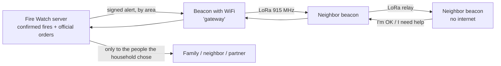

# Home Beacon: build plan (pilot)

Written 2026-11-25. **Status: a plan only. It is not approved to build (decision #27), and nothing here changes the v1
kit.** Background and the problem it solves: `docs/FUTURE.md` → "Option: Fire Watch Home Beacon". Rules for
selling hardware: `docs/PRODUCT_PLAN.md` § 4. First responders: `docs/PRODUCT_PLAN.md` § 6. Prices were checked on the
sellers' own pages on 2026-11-25; anything not checked is marked *estimate*.

**Update 2026-11-26: the founder adopted the Help-First pilot version** (a Leave-Early Plan plus a bedside beacon with
its own cell connection, about $125–150; decision #39, `docs/BEACON_RECOMMENDATION.md`). Where they differ, it replaces
the parts list (§ 3), the Meshtastic firmware and alarm rules (§ 6), the weather-radio and satellite verdicts (§ 2a: a weather-radio alert would never set off the siren), the pilot plan (§ 11) and the costs (§ 12) below. The $125–150 is an *estimate*: some parts aren't priced.

## 1. What it is, and what it must never claim
A small box in the home that keeps working when phones and internet don't:
1. **Relays confirmed fire alerts and official evacuation orders** from house to house over LoRa radio (915 MHz).
   One beacon with WiFi, or a solar relay at a school or fire station, feeds the neighborhood.
2. **Sounds a loud alarm and flashes a light** in the home: for people without smartphones, people who are asleep,
   and people who are hard of hearing.
3. **Has two big buttons, "I'm OK" and "I need help",** whose status reaches the people the household chose (§ 8).
4. **Shows status** on its small screen: "Alerts on", battery level, "Last alert 2 h ago".

It must **never** claim or do the following. This wording goes on the box, the screen and the guide:
- **It is not a smoke alarm.** Keep your smoke alarms; this doesn't replace them or have their UL 217 listing.
- **It does not call 911.** "If you need help now, call or text 911."
- **It doesn't replace official alerts or evacuation orders.** "If officials tell you to leave, or you feel unsafe,
  leave right away. Don't wait for this box."
- **It never sounds for one sensor's smoke reading or for a "possible" fire.** Only confirmed alerts and official
  orders set off the alarm (§ 6).

## 2. How it works

Every beacon both **receives and relays**. When cell towers or home internet fail, alerts that reached any beacon in
range keep hopping between houses. **A beacon with no other beacon in range needs its own backup paths:** see § 2a.

## 2a. A beacon on its own: alerts with no internet and no other beacons
Researched 2026-11-26 from primary sources (NWS directives, FCC outage reports, eCFR, maker pages). Every claim was then
re-checked against its source by a separate reviewer. Prices are snapshots, so recheck them before buying.

**The problem:** LoRa only passes along an alert that some beacon has already received. A home with no other beacon in
range depends entirely on its own internet. When that's down, the beacon as planned gets nothing, and it can't tell
the household that it's missing alerts.

**Short answer: no path covers every outage, alone or combined.** In the Lahaina fire all three below would likely have
failed: home internet and most cell sites were down, and Iowa State's archive shows no fire or evacuation alert on
weather radio. Each
layer covers part of the gap:
1. **Home internet** (WiFi): what the plan has now.
2. **A second way to reach Fire Watch:** covers outages where home internet or power is out but cell towers still
   work. Either the household's phone passes alerts to the beacon over Bluetooth through the Fire Watch app (free, but
   the phone has to be home), or a cell modem inside the beacon does it without a phone (≈ $15–40 + ≈ $1/month).
3. **NOAA Weather Radio:** of these paths, the only one that can keep working with power, internet and cell all down.
   That holds only while the transmitter has backup power (most do, not all) and the radio has batteries. **It only
   carries a fire or evacuation alert if officials send one there, and for the biggest recent fires Iowa State's
   archive shows none** (Los Angeles still to be confirmed with NWS Los Angeles).

Community relays help where a partner hosts one.

**Without a phone or home internet, the beacon can reach the Fire Watch server two ways:** its own cell modem
(Path 2), or LoRa hops to any beacon or relay in range that still has a connection (§ 2 and Path 3). Shared IoT
networks such as Helium or Amazon Sidewalk also exist, but they depend on other people's internet and haven't been
checked. With cell towers down and nothing connected in range, only satellite gives a two-way link, and the weather
radio only receives.

**The box never replaces official orders:** if officials tell you to
leave, or you feel unsafe, leave right away (§ 1).

### Path 1: NOAA Weather Radio (NWR)
**What it is:**
- The National Weather Service runs about 1,036 transmitters on seven fixed channels (162.400–162.550 MHz).
- It's free, with no account and no internet. "Most stations have emergency power", which means not all of them
  ([NWSI 10-1711](https://www.weather.gov/media/directives/010_pdfs/pd01017011curr.pdf)).
- Weather radios read a short digital code at the start of each alert, called **SAME**. It says what kind of alert it
  is and which county it's for ([NWSI 10-1712](https://www.weather.gov/media/directives/010_pdfs/pd01017012curr.pdf)).

**What it carries for fires:**
- **Fire Warning (FRW)** and **Evacuation Immediate (EVI)** both sound the radio's alarm, day or night
  ([NWSI 10-1710](https://www.weather.gov/media/directives/010_pdfs/pd01017010curr.pdf), Table G-2).
- Officials also use **Civil Emergency Message (CEM)** and **Local Area Emergency (LAE)**. Boulder County has sent EVI
  and CEM before. At night a CEM may go out with no alert tone (a local option), and an LAE never carries the tone, so
  a radio may stay silent for them. **Leave those codes switched on, and ask each county which codes it uses.**
- **The NWS doesn't write these alerts.** Government alerting officials (usually the county or the state) send them
  through FEMA's alert system (IPAWS), or ask the local NWS office to relay them.
  - NWS rules tell the on-duty forecaster to accept a relay request from a verified official even when the official's
    internet or IPAWS is down ([NWSI 10-518](https://www.weather.gov/media/directives/010_pdfs/pd01005018curr.pdf)
    §§ 3.1, 3.3.2). The official still needs a phone or another way to reach the office.
  - Alerts relayed that way can't reach phones as emergency alerts (WEA). Weather radio may then be the only channel
    carrying them.
- **Red Flag Warnings (fire weather) have no SAME code**, so radios don't sound for them.

**The catch: officials often don't use it for fires.** These counts come from Iowa State's archive of NWS messages,
a third party. They show what's in that archive, not proof of what aired, so confirm them with the NWS offices before
quoting them publicly.
- **Use is growing:** Fire Warnings nationwide rose from 5 in 2015 to 120 in 2026 (to Nov 26).
- **It's concentrated:** most Fire Warnings come from the Texas Panhandle and Oklahoma (about 250 of 425 since 2015).
  Evacuation Immediate messages also cluster around NWS Medford (southwest Oregon and far-northern California).
- **Five California NWS offices** (Los Angeles, Sacramento, San Diego, Bay Area, Hanford) relayed 7 Fire Warnings in
  total from 2015 to 2026.
- **For the biggest recent fires, the archive has no Fire Warning or Evacuation Immediate on weather radio:**
  - **Lahaina 2023:** none from NWS Honolulu, then or at any time since 2015.
  - **Los Angeles, Jan 7–10, 2025:** none from NWS Los Angeles, although about 3,500 weather radios had been handed out
    in one supervisorial district. The county's own review lists NOAA Weather Radio among the tools used during the
    fires ([LA County review](https://file.lacounty.gov/SDSInter/bos/supdocs/207915.pdf)), so ask NWS Los Angeles what
    actually aired.
  - **Marshall Fire, Boulder County, Dec 30, 2021:** none for Boulder County.

**Other limits:**
- **Alerts cover a whole county.** An evacuation in one corner of LA County (about 10 million people) would sound every
  radio in the county. Only 8 NWS offices can target part of a county ([NWS](https://www.weather.gov/pca/)). Some
  transmitters don't sound alert tones for every part of the counties they cover, so **setup must pick the right
  transmitter for the home, not just the county.**
- **Coverage:**
  - The NWS says it can potentially reach over 95% of the US population.
  - A full-power transmitter reaches about 40 miles over flat land.
  - Real coverage can be 5–10% below the maps ([NWS](https://www.weather.gov/nwr/Maps)). There are dead spots in
    mountains and forests, which is where wildfires happen, and reception can change from room to room.
  - 14 of 1,036 transmitters were out of service on 2026-11-26.
- **A county test went out coded as a real Fire Warning, for the wrong county.** On Oct 5, 2026, a Douglas County,
  Colorado test was addressed to Elbert County. It's not known whether it set off radios. It came through NWS Boulder,
  which serves the proposed Front Range pilot (§ 11).
- **Batteries:** the Midland WR120 lasts about 75 hours on standby and about 5 hours while sounding, on 3 AA cells.
  Lahaina lost grid power for several days, so keep spare batteries by the radio.
- **Weekly test:** NWS offices are told to send a test on Wednesdays between 10 a.m. and 1 p.m. local time, but they
  skip it when severe weather threatens. Many radios only light up for the test and don't sound (the WR120 by default).

**How the beacon could use it:**

| Option | Cost per home | Monthly | Verdict |
|---|---|---|---|
| **B. A weather radio placed next to each beacon**, not connected | About $20 to over $100 ([NWS](https://www.weather.gov/nwr/nwr_receivers)), plus 3 AA batteries | $0 | **Stopgap for the 5-prototype pilot** until A passes its bench test. It gives an offline alarm with no engineering and no wiring change, but the beacon doesn't know about the alert: no check-in prompt, no relay to neighbors, and a second device to look after. **It isn't the product** |
| **A. Wire the radio to the beacon** through the radio's external-alert jack | About $50 for a radio with the jack, such as the Midland WR120 (search snippet, not verified; the NWS's $20 low end is for radios without one). Plus a 3.5 mm cable, an optocoupler and a resistor (not priced) | $0 | **Bench-test first; the likely pilot choice if it passes** (see "Does the radio alert for tests?" below). The jack is only an on/off signal: the beacon can't tell what the alert is, which part of the county it covers, or whether it's a test. **So the beacon wouldn't sound its own siren** (the radio's siren is the alarm). Instead it would flash its light, show "Weather radio alert: listen to the radio" and ask "I'm OK / I need help". It wouldn't relay the alert over LoRa. If the jack also fires for the weekly test, the beacon would do this every Wednesday, unless it treats a short trigger on Wednesday between 10 a.m. and 1 p.m. as a test (bench-test how long the trigger lasts). Midland doesn't publish how the jack behaves electrically. A also needs a spare input pin, which the RAK3312 may not have, and a jack hole in the case. That's a wiring change, so the founder decides |
| C. Build a receiver chip into the beacon (Si4707, which decodes SAME) | Unknown | $0 | **Not now.** The maker dropped it from its programming guide in Oct 2024 and the hobby boards are retired, so it's probably discontinued. It would also need FCC receiver testing |
| **E. Build a receiver into the beacon and read the code in our own software** | Unknown | $0 | **The goal for a product:** one box that knows what the alert is (type, county, test), shows it, sounds only for fire and evacuation, and asks for a check-in. The code format is published (NWSI 10-1712), so decoding it in firmware is doable. Needs a weather-band receiver chip that's still in production, firmware work, and FCC receiver testing. Not researched yet |
| D. A walkie-talkie radio module tuned to NWR | Unknown | $0 | **No:** it contains a transmitter, and one such module (NiceRF SA818Pro) draws 76 mA just listening |

**New steps for the household (founder decides, since these are recipient steps):**
- A volunteer programs the county code, and picks a transmitter that sends alert tones for that home (its page on
  weather.gov lists "Areas Receiving Alert Tones").
- The volunteer checks reception where the radio will sit.
- The household keeps the radio plugged in, with AA batteries in it.

Sounding the beacon's siren, or flashing its light, for weather-radio alerts would change § 1 and § 6 (the light is part
of the alarm there), so that's also the founder's call.

**Does the radio alert for tests? (founder's question, 2026-11-26)** Probably not for routine tests, but it isn't
confirmed:
- The Midland WR120's manual says weekly and monthly tests only light an LED and show a message; its siren for tests is
  off by default. Nobody publishes whether the alert jack fires for a test. **That's the bench test.**
- **If the jack doesn't fire for tests,** set the radio to sound only for **Fire Warning (FRW)** and **Evacuation
  Immediate (EVI)** for the home's county. Its manual has a menu for switching alert types on and off; confirm it on the
  bench. The jack firing then effectively means "an official fire or evacuation alert for this county".
- **The beacon could then sound its own alarm** for it, which fits § 1, because these are official alerts. It's still
  the founder's call, and it still has limits:
  - it covers the whole county, not the neighborhood;
  - a test sent out coded as a real alert is rare, but it has happened (Colorado, Oct 5, 2026);
  - **Civil Emergency (CEM)** is a trade-off. Officials sometimes send evacuations under it (Boulder County has), but
    it's also used for things like power outages. Including it catches more evacuations but adds non-fire alarms.

### Path 2: Cellular backup
**What it is:** a small **LTE-M** modem (a low-power kind of cell connection made for devices) inside the beacon. When
WiFi is down, the beacon checks the Fire Watch server over the cell network instead.

**When it helps:**
- **In power shutoffs, most cell outages come from lost power, not damage.** On Oct 28, 2019, during California's
  shutoffs, 874 of 26,169 cell sites in the 32 counties the FCC tracked were out (3.3%), and 702 of those 874 were down
  for lack of power ([FCC report, Oct 28, pp. 13–14 of this mirror](https://www.tellusventure.com/downloads/fcc/2019/fcc_communications_status_report_california_30oct2019.pdf)).
  That average includes big counties the shutoffs barely touched (Los Angeles 0.2%). The hardest-hit counties were far
  higher: Marin 57%, Calaveras 39%, Sonoma 27%.
- **California now requires 72 hours of backup power** at cell sites in high fire-threat areas, with exceptions. The
  rule took effect in July 2020, after those shutoffs
  ([CPUC](https://www.cpuc.ca.gov/-/media/cpuc-website/industries-and-topics/documents/internet-and-phone/communications-resiliency-updates_final-12132024.pdf)).
- **Home internet can stay down longer than cell service.** On Maui, all 21 West Maui cell sites were working again by
  Aug 20, 2023. Cable and phone companies still reported 14,466 subscribers out (phone, TV and/or internet; the count
  doesn't separate out homes that burned) ([FCC](https://docs.fcc.gov/public/attachments/DOC-396157A1.pdf)).

**When it fails:** when towers burn or lose power.
- **West Maui:** 19 of 21 cell sites were out after the Lahaina fire ([FCC](https://docs.fcc.gov/public/attachments/DOC-395981A1.pdf)).
- **Marin County:** 57% of cell sites were out on Oct 28, 2019 (134 of 160 for lack of power), before the 72-hour rule.

**Cost (snapshots, not verified):** roughly **$15–40 per beacon** plus about **$1 a month**.
- **Modem:** SIMCom SIM7080G, about $11–23. It's a surface-mount part that needs its own circuit board.
- **SIM card:** $3–14.
- **Not yet priced:** the antenna and the power parts.
- **Prototype board:** the hand-built pilot would use a ready-made board like the LilyGO T-SIM7080G-S3 (about $30; one
  snapshot showed it sold out). It has no LoRa radio or screen, so it sits next to the Heltec rather than replacing it.
- **Data:** about $0.60–1.10 a month if use stays under a few MB (Soracom 1 MB for $0.60;
  [Hologram](https://www.hologram.io/pricing/) $1 plus $0.03 per MB). Real use isn't measured yet, and it depends on
  how often the beacon checks in. Or 1NCE: $14 once for 10 years and 500 MB, though it may be for businesses only.
- **Beyond home-built prototypes:** a cellular device may also need network certification, for example CTIA IoT Network
  Certified at $1,500 per design plus lab fees.

**Design notes:**
- **The server can't reliably push an alert to the beacon on these SIMs.** A Nordic engineer says that on resold IoT
  SIMs like these, the network often closes an idle connection within about a minute. That's a forum answer, not a
  spec, so measure it on the bench. Plan for the beacon to check in regularly, or be woken by a text message.
- **Listening costs battery:** the SIM7080G draws about 10 mA while idle, or 0.6 mA in its sleep mode
  ([SIMCom](https://en.simcom.com/product/SIM7080G.html)). At 10 mA it would cut § 6's ~12-day battery estimate
  (≈ 15 mA average) to about a week. Measure which mode can still receive a wake-up text.
- **Could the modem receive official phone alerts (WEA) directly?** We found no source confirming that US carriers send
  them to this kind of modem, so don't count on it.

**Verdict: worth a bench test** as the beacon's second path. It changes the cost per beacon and adds a monthly fee, so
it's the founder's call (decision #36).

**A free alternative for the same case: the household's phone, through the Fire Watch app** (added 2026-11-26).
Fire Watch is already a native iOS and Android app; the v1 sensor kit's "no app" rule doesn't apply to the beacon,
which links to Fire Watch.
- **How it works:** when home WiFi is down but the phone still has cell data, the Fire Watch app receives the signed
  alert and passes it to the beacon over Bluetooth. "I need help" presses can go out the same way.
- **Why it's still useful when the phone already has the alert:** the beacon sounds loudly for people in the home
  without a phone, or asleep. It also relays the alert to neighbors' beacons over LoRa, so one phone with signal can
  feed a street.
- **Catches:**
  - the phone has to be home and in Bluetooth range;
  - iOS may stop a background app (Apple allows background Bluetooth but doesn't guarantee it);
  - pairing the phone is a new household step;
  - it needs work in the Fire Watch app.
- **Cost:** $0 in hardware.
- **Verdict: prototype it alongside the cell modem.** It may cover enough homes that the modem is only needed where
  nobody has a smartphone.

### Path 3: Community relay
**What it is:**
- A solar-powered LoRa relay on a fire station, school, water tower or hilltop. It covers every beacon in range,
  including a home with no neighbors who own one.
- **Getting alerts:** the relay node itself only has LoRa and Bluetooth. It also needs a gateway at the host site to
  get alerts: a WiFi-connected node on the host's internet, or a cellular modem. Alerts from those come from the Fire
  Watch server and are signed, so beacons can sound.
- **A weather-radio receiver at the relay is different.** The server can't sign what the relay hears offline.
  Proposed (the founder decides, because it's recipient-facing wording and a new relay-signed message type that § 6
  would need): send those as a lower level ("Weather radio alert nearby: check your radio or local news"), signed
  with the relay's own key, and never as a confirmed alert or order.
  - **Never pass on the alert codes or the alert tone themselves over LoRa**
    ([47 CFR 11.45](https://www.ecfr.gov/current/title-47/chapter-I/subchapter-A/part-11/subpart-B/section-11.45)).
  - An open-source Meshtastic bot (meshing-around, GPL-3.0) documents an example as developer notes: a USB radio
    (RTL-SDR) feeds a separate decoder (multimon-ng, GPL-2.0) on a small computer, which needs more solar power. It's a
    starting point, not a tested product: it doesn't filter by alert type, county or tests. Using it would be a new GPL
    dependency, so the founder decides.

**Cost:** about **$66–299 per relay node**, shared by every home in range, plus a gateway that isn't priced yet.
- Seeed SenseCAP Solar Node P1, $65.61 ([Seeed](https://www.seeedstudio.com/SenseCAP-Solar-Node-P1-for-Meshtastic-LoRa-p-6425.html)),
  without its four 18650 batteries.
- Elecrow ThinkNode M6, from $74.90.
- RAK WisMesh Repeater with a solar kit, $299.

**Range is the big unknown:**
- **At most about 1 km** in towns or forest with both radios low. That was the farthest any packet got through in one
  868 MHz study ([KU Leuven](https://lirias.kuleuven.be/retrieve/552000)).
  - The same study found 80% delivery at about 200 m in town, forest and coastal sites. Both radios were outdoors at
    1.5 m, with no retries.
- **"A couple of km"** with a tuned antenna and few obstacles ([Meshtastic](https://meshtastic.org/docs/hardware/antennas/antenna-testing/)).
- **Several km or more** from a high site with a clear line of sight.
- **No study measured a high relay talking to an indoor beacon.** Walls make it worse; height makes it better. So
  range-test from the real site to real indoor spots before promising anyone coverage.

**Rules:**
- **Use the normal license-free rules (FCC Part 15), and run each relay as certified.** Keep its own antenna, or one
  of the same type with equal or lower gain
  ([15.204](https://www.ecfr.gov/current/title-47/chapter-I/subchapter-A/part-15/subpart-C/section-15.204)).
  The band's 1 W and 6 dBi figures are ceilings, not permission to add an amplifier or a bigger antenna. The device's
  FCC grant decides.
- **Ham radio can't be used.** It bans encryption (messages coded to hide their meaning), broadcasting and most one-way
  messages, relaying other stations such as NOAA, and messages the operator has a money interest in, with narrow
  exceptions ([47 CFR 97.113](https://www.ecfr.gov/current/title-47/chapter-I/subchapter-D/part-97/subpart-E/section-97.113)).
- **Alerts must be signed.** Meshtastic's default channel key is public, and its newer message signing still accepts
  unsigned messages by default. So the beacon must check signatures itself.

**Real examples:**
- **Clinton County, Ohio (2025):** three solar emergency Meshtastic nodes, plus a separate amateur-radio club node on
  the local hospital.
- **Jefferson County, Florida:** proposed.
- **Lamar County, Texas:** a grant application.

**Verdict: the long-term answer for neighborhoods**, and it fits the plan to partner with fire departments. It needs a
host site, a gateway and a range test.

### Not recommended
- **Satellite messaging (Iridium RockBLOCK):** about $300 per beacon plus about $15 a month. It needs an outdoor
  antenna with a clear view of the sky ([SparkFun](https://www.sparkfun.com/rockblock-9603n-iridium-satcomm-module.html)).
- **Satellite-capable cell modems (NB-NTN):** new, cost $0.80 per KB of data, and probably need a view of the sky.
  Worth watching.
- **Higher-power ham or GMRS radio:** not legal for this.

### Always show which paths are working
A beacon that silently misses alerts is worse than no beacon. Proposed (needs the founder's OK, because it's
recipient-facing wording):
- **The screen shows each path,** for example "Internet ✓ · Phone ✓ · Cellular –".
- **The weather radio** can show ✓ only if the beacon has a way to see it working. A wired radio (A) qualifies only if
  the bench test shows its jack reports the weekly test. A radio placed next to the beacon (B) can't be shown at all;
  it has its own check instead. Per its manual, the WR120 shows "CHECK RECEPTION" and beeps every 10 minutes if it
  hears nothing for 10 days.
- **If no path works,** the screen says "Not receiving alerts" and the beacon chirps. Pick the interval on purpose: a
  smoke alarm's low-battery chirp repeats every 30–60 seconds, and the beacon's own low-battery rule is one chirp an
  hour.

### Costs of the backup paths
| Path | Per beacon (one-time) | Monthly | Notes |
|---|---|---|---|
| Weather radio next to the beacon (B) | ≈ $20–100+ | $0 | 5 pilot units: about +$100–500 |
| Weather radio wired to the beacon (A) | ≈ $50 radio + parts not priced | $0 | After a bench test |
| Phone over Bluetooth (Fire Watch app) | $0 | $0 | The phone must be home; app work needed |
| Cellular backup | ≈ $15–40 (prototype board ≈ $30) | ≈ $1 (not measured) | Plus network certification for a product |
| Community relay | ≈ $66–299 per node + a gateway (not priced), shared | $0 if the host provides internet | Per-home cost depends on how many homes it reaches |

### Next steps
1. **Founder (outside contact):** for each pilot area, ask the county emergency office, the state emergency office,
   and the local NWS office's Warning Coordination Meteorologist:
   - whether they send Fire Warnings or evacuation orders to NOAA Weather Radio;
   - which codes they use;
   - whether the transmitter has backup power.
2. **Bench test:** connect a Midland WR120's alert jack to the beacon. Measure the voltage and how long it stays on.
   Check whether a weekly test triggers it, and confirm the radio can be set to Fire Warning and Evacuation Immediate
   only.
3. **Bench test:** the LilyGO T-SIM7080G-S3 as a cellular backup. Measure data use, battery draw in each mode, and
   wake-up by text.
4. **Prototype:** the Fire Watch app passing a signed alert to the beacon over Bluetooth, including with the app in
   the background on iOS and Android.
5. **Range test:** a solar relay at a real fire station or school, reaching indoor beacons.
6. **Research:** a weather-band receiver chip that's still in production, for option E.
7. **Decide #36 and #37** (`docs/decisions.md`).

This is all beacon work (a later phase). None of it changes the v1 sensor kit.

## 3. Parts for one pilot beacon (two-box design: the air sensor stays outside, this box has no PMS)
| # | Part | Qty | Price (1 unit) | Source | Why this one |
|---|---|---|---|---|---|
| 1 | **Heltec WiFi LoRa 32 V3**, 863–928 MHz version (ESP32-S3 + SX1262, screen, battery charger; includes a LoRa antenna and battery plug) | 1 | $17.90–19.90 | [heltec.org](https://heltec.org/project/wifi-lora-32-v3/) | WiFi + Bluetooth + LoRa on one board; Meshtastic supports it; well documented |
| 2 | **Li-ion pack, 3.7 V 4400 mAh** (2 × 18650, built-in protection) | 1 | $19.95 | [Adafruit 354](https://www.adafruit.com/product/354) | Protection against over-charge, over-discharge and over-current; cuts out at 2.5 V |
| 3 | **12 V boost regulator**, Pololu U3V16F12 | 1 | $7.95 | [Pololu 4945](https://www.pololu.com/product/4945) | Starts at 2.7 V, so it runs the siren from the battery; draws under 1 mA when idle |
| 4 | **Piezo alarm**, SparkFun COM-13939 (5–16 V, 16 tones) | 1 | $7.55–7.95 | [SparkFun](https://www.sparkfun.com/large-piezo-alarm-16-tone.html) | 103 dB(A) at 16 V and 90 dB(A) at 5 V, both at 61 cm; ~40 mA ([DigiKey listing](https://www.digikey.ca/en/products/detail/sparkfun-electronics/13939/17830296)). **The printed case is now sized for the Amazon prototype's square 12 V siren (47 × 39 × 23.5 mm, up to 120 mA, price not verified)**; this round one needs `siren_l/w/h` = 35.8 / 35.8 / 35.7 and a reprint |
| 5 | **30 mm arcade buttons with LED**, green ("I'm OK") + red ("I need help") | 2 | $2.50 each | [Adafruit 3487](https://www.adafruit.com/product/3487), [3489](https://www.adafruit.com/product/3489) | Big and easy to press; 30 mm hole. **The red 3489 won't light from a 3.3 V pin**: Adafruit says its red and yellow LEDs are two in series and need 5 V or more. The green one runs dim at 3.3 V. See the open question in § 4 |
| 6 | **N-channel MOSFET** (logic-level, TO-220): IRLZ34N or IRLZ44N | 2 | $1.50 each (IRLZ34N, SparkFun COM-24144) | [SparkFun COM-24144](https://www.sparkfun.com/n-channel-mosfet-55v-30a.html) (IRLZ34N), or an IRLZ44N 10-pack on Amazon | Lets the board switch the siren and the light (gate threshold 2.0 V max, so 3.3 V logic works). The earlier pick, IRLB8721 / Adafruit 355, is obsolete at DigiKey and out of stock at Adafruit |
| 7 | **Perfboard, 2 × 8 cm**, cut to 50–53 mm long (small solder board for the drivers) | 1 | $2.25 for 3 | [Adafruit 4858](https://www.adafruit.com/product/4858) | 20 mm wide; the case pocket was resized for it on 2026-11-26. The FeatherWing Proto (Adafruit 2884) is out of stock |
| 8 | **UL-listed 5 V USB-A supply + USB-A-to-C cable** | 1 | $10.90 | [Adafruit 501](https://www.adafruit.com/product/501) ($5.95) + [4474](https://www.adafruit.com/product/4474) ($4.95) | The 501's page links its UL certificate. USB-A, not C-to-C: Meshtastic warns the V3 may not charge its battery over C-to-C. (Replaced the Adafruit 5802, which is out of stock and has an off switch) |
| 9 | 12 V white LED strip, one 50 mm segment (3 LEDs, 60 mA at 12 V) | 1 | ≈ $1 *estimate* | spec: [Adafruit 887](https://www.adafruit.com/product/887) (that reel is discontinued) | A visible flash. **Not a certified strobe** (§ 13) |
| 10 | Resistors: 2 × 100 Ω, 2 × 100 kΩ, 2 × 10 kΩ | — | ≈ $0.30 *estimate* | any | Gate resistors, gate pull-downs, button pull-ups |
| 11 | Wire, a JST-PH to SH1.25 battery lead, button quick-connects, heat-shrink | — | ≈ $3 *estimate* | any | |
| 12 | Printed case (`hardware/beacon/`), ~75–95 g PETG/PLA, + 4 × M3 × 10 self-tapping screws | 1 | ≈ $2.50 *estimate* | — | |
| | **Total, pilot, from US shops** | | **≈ $84** (verified items ≈ $77 + estimates ≈ $7; was ≈ $83 before the transistor, solder-board and power-supply swaps on 2026-11-26) | | |

**Cost compared with earlier estimates:**
- **Earlier estimate:** `docs/FUTURE.md` estimated about $47. That assumed cheaper equivalents: a bare 18650 cell with
  a holder, a generic siren and generic buttons. Those weren't re-checked here.
- **Lean pilot:** swapping in those equivalents gives roughly **$50–55** (*estimate*).
- **At volume:** a custom circuit board, molded case and bulk parts bring it to roughly **$26–40** (FUTURE.md
  estimate; needs factory quotes).
- **5 pilot units:** about **$420**, including the estimate lines. Add a soldering iron and a multimeter if you don't have
  them.

**One-box variant (adds the PMS5003 so the beacon also measures smoke):**
- **Extra parts:**
  - the PMS5003, about $10–20 (FUTURE.md);
  - a 5 V supply for its fan when on battery, *estimate* $5–8, because the board's 5 V pin only works on USB power
    ([Heltec datasheet](https://resource.heltec.cn/download/WiFi_LoRa_32_V3/HTIT-WB32LA_V3.2.pdf), § 3.3).
- **A different case:** it needs an open-bottom air path like the outdoor case, so it isn't generated here.
- **Total:** about **+$18–30** per unit.
- **Placement trade-off:** it only reads *indoor* air unless it's placed near a window. That's why two boxes are
  recommended (decision #28).

**Buying a prototype quickly (Amazon):** see `docs/HOME_BEACON_PROTOTYPE_BUY.md` (parts matched to the printed case).

### 3a. Parts check (2026-11-26): are these the cheapest and the best?
**Short answer: no.** The parts above were picked to be easy to buy and well documented, not cheapest or best. A second
check compared every part with the alternatives, using prices from each seller's own page on 2026-11-26. Each price was
then re-checked by a separate reviewer. DigiKey and Mouser blocked automated checks, so their prices are marked.

**Out of stock today:** the Adafruit 5802 power supply, the FeatherWing Proto and the Adafruit 355 MOSFET (all three
since replaced above: lines 6, 7 and 8). The 12 V LED strip (line 9) is discontinued. The prototype's in-stock
buy list is `docs/HOME_BEACON_PROTOTYPE_BUY.md`.

| Part | Current pick | Cheapest that works | Best | Why |
|---|---|---|---|---|
| Radio board | Heltec V3 $17.90 | **Seeed XIAO ESP32S3 + Wio-SX1262 kit, $11.99** (US warehouse, duty-free) ([Seeed](https://www.seeedstudio.com/Wio-SX1262-with-XIAO-ESP32S3-p-5982.html)) | **RAK WisMesh RAK3312 starter kit (RAK19007 base), $28.99** ([RAK](https://store.rakwireless.com/products/meshtastic-starter-kit-esp32-s3-lora-sx1262)) | The V3 is neither. **Seeed:** WiFi + LoRa, both radio parts FCC modular-approved, but only community-level Meshtastic support and a slow 100 mA charger. **RAK3312:** the only WiFi + LoRa board with a modular FCC approval (2AF6B-3112; the $15 bare module can go on our own board later), full Meshtastic support, a 350 mA charger and a JST-PH plug that fits the battery. Its LoRa receive draw is 25 mA (module, WiFi off) vs the V3's 90 mA (whole board), so it should last much longer on battery; bench-measure to confirm. It has only about 4–6 free pins (enough for 2 buttons, siren and light). **Same-price upgrade:** the **Heltec V4.3 R2, $17.90** ([Heltec](https://heltec.org/project/wifi-lora-32-v4-r2/)) has the same pin plan as the V3, a 540 mA charger, 75 mA listening and a stronger radio |
| Ready-made device instead | n/a | Elecrow ThinkNode M2, $20.90 without battery (FCC 2BDNA-CL06) | none | No ready-made Meshtastic node has a smoke-alarm-loud siren or big buttons, and the long-battery ones have no WiFi. A ready-made node + siren comes out the same or higher than DIY. **Keep the DIY beacon** |
| Battery | Adafruit 354 4400 mAh $19.95 | Keep the 354 (a loose protected 18650 + holder saves ~$4 in parts, but two extra shops' shipping cancels it for 5 units) | **Adafruit 5035 10,050 mAh, $29.95** ([Adafruit](https://www.adafruit.com/product/5035)) | Protected, lowest cost per Ah ($2.98 vs $4.53), about 2.3× the runtime for $10 more, and 37 Wh (under the 100 Wh mailing limit). Neither Heltec board has its own battery-protection chip, so always use a protected pack |
| Alarm | SparkFun COM-13939 + Pololu 12 V boost ($15.90) | Same Sky CPI-5029-105T $7.25 + boost (meets 85 dB at 3 m on paper, **no margin**, only 39 in stock) | **Same Sky CPS-7560-110L450, $9.37** + the same boost | It's guaranteed 105 dB at 1 m, about 95 dB at 3 m: roughly 10 dB above the smoke-alarm yardstick (UL 217: 85 dBA at 10 ft, [CPSC report](https://www.cpsc.gov/s3fs-public/audibility%20(1).pdf)). The current pick only just reaches it (~84–88 dB), and a closed door takes ~10 dBA. **$1.42 more** |
| Siren/light driver | IRLZ34N $1.50 ×2, or IRLZ44N (replaced the out-of-stock Adafruit 355) | PN2222 transistors, 10 for $1.95 ([Adafruit 756](https://www.adafruit.com/product/756)) | Infineon IRLZ44N ×2 (~$1.80 each, Mouser, tariff note), or Adafruit 5648 driver boards ($3.95 each, no soldering of small parts) | The loads are small (siren ~0.15 A at 12 V) |
| Buttons | Adafruit 30 mm LED buttons $2.50 ×2 | same | same (a 60 mm "I need help" button, $5.95, for older users needs a bigger case) | Nothing cheaper with an LED from a listed shop. The red one may not light at 3.3 V at all (§ 4) |
| Wall power | Adafruit 501 + USB-A-to-C cable $10.90 (replaced the out-of-stock 5802) | Adafruit 5801, $5.95 (same UL file), after a bench test | **Adafruit 501 UL-listed 5 V supply + USB-A-to-C cable, $10.90** (cable: Adafruit 4474, $4.95 on 2026-11-26) | Meshtastic warns the Heltec V3 may not charge its battery over USB-C-to-C, and the 5801/5802 have an on/off switch a resident could turn off, after which the battery quietly drains |
| Light | 12 V strip (discontinued) | Adafruit 5864 strip, a 5 cm cut ≈ $0.40 | same, plus a **bed shaker** ($17.99, Sonic Alert) for deaf or hard-of-hearing households | The LED isn't a certified visual alarm (decision #31) |
| Solder board | 2 × 8 cm perfboard, Adafruit 4858, $2.25 for 3 (the case now fits it) | SparkFun PRT-08808, ≈ $1.48 (check it fits the 20 × 53 mm pocket) | same | |

**Three ways to build one pilot beacon** (single-unit prices, plus about $6 of resistors, wire, battery adapter and
printed case):
| Build | Board | Battery | Alarm and driver | Power | Per beacon | Battery while off-grid (*estimate*, before bench tests) |
|---|---|---|---|---|---|---|
| **Lean** | Seeed XIAO kit $11.99 | Adafruit 354 4.4 Ah | CPI-5029-105T + boost + PN2222 | 501 + cable | **≈ $71** | ~1.5–3 days awake; more in power-save |
| **Balanced** | Heltec V4.3 R2 $17.90 | Adafruit 5035 10 Ah | CPS-7560 + boost + IRLZ44N | 501 + cable | **≈ $93** | ~4–5 days awake |
| **Best** | RAK3312 kit $28.99 | Adafruit 5035 10 Ah | CPS-7560 + boost + IRLZ44N | 501 + cable | **≈ $104** | possibly 1–2 weeks (if the 25 mA figure holds) |
| Plan as written (updated 2026-11-26) | Heltec V3 | 354 4.4 Ah | COM-13939 + boost + IRLZ44N | 501 + cable | ≈ $84 | ~1.5–2 days awake |

**Recommendation:**
- **Bench test before choosing a board:** buy one **Heltec V4.3 R2** ($17.90) and one **RAK3312 kit** ($28.99), about
  $47. Measure real battery drain, charging and free pins with Meshtastic, then order 5 of the winner.
- **For a future product, lean toward the RAK3312:** its certified module is what we'd put on our own board, and battery
  life during an outage is the beacon's whole point.
- **Pick the louder siren and the 10 Ah battery either way.** Both are about safety, and the extra cost is small.
- **The case:** the generated case fits only the Heltec V3, and battery packs up to about 70 × 37.5 × 19 mm (the
  4,400 mAh Adafruit 354, or the 5,200 mAh backups in the buy list). A Heltec V4 / V4.3 (51.7 mm long:
  set `board_l` 51.7 and `board_t` 10.7), a RAK board or the 10 Ah pack needs the board pocket and battery bay resized
  (`hardware/beacon/make_beacon_case.py` parameters).
- **Not checked:** shipping, tariffs and DigiKey/Mouser prices. Mouser shows tariff notes of 10–38% on some imported
  parts.

## 4. Wiring
### Pin map (Heltec V3)
Sources:
- [Heltec pin map](https://heltec.org/wp-content/uploads/2023/09/pin.png)
- [Arduino board definition](https://github.com/espressif/arduino-esp32/blob/master/variants/heltec_wifi_lora_32_V3/pins_arduino.h)
- [Meshtastic board definition](https://github.com/meshtastic/firmware/blob/master/variants/esp32s3/heltec_v3/variant.h)

| What | Header pin | GPIO | Notes |
|---|---|---|---|
| Siren switch (MOSFET 1 gate) | J2-13 | 47 | via 100 Ω; 100 kΩ gate-to-GND so it stays off while booting |
| Light switch (MOSFET 2 gate) | J2-14 | 48 | same as above |
| "I'm OK" button | J3-15 | 4 | to GND when pressed; 10 kΩ pull-up to 3V3; can wake the chip from sleep |
| "I need help" button | J3-16 | 5 | same |
| Green button LED | J3-17 | 6 | the button LED is rated 5 V 10 mA; dimmer at 3.3 V |
| Red button LED | J3-18 | 7 | same, **but may stay dark at 3.3 V** (see below) |
| Silence / test | on-board PRG button | 0 | don't hold it while plugging in (boot pin) |
| 3.3 V for pull-ups | J3-2 | — | |
| GND | J3-1 / J2-1 | — | one common ground for everything, including the boost and MOSFETs |
| Battery voltage | on-board | 1 (+37 enable) | already wired on the board |

**Open question: the red button's LED at 3.3 V (2026-11-26).** Adafruit says its red and yellow 30 mm LED buttons
have two LEDs in series and "cannot run at 3.3V"; its green, blue and white ones run dim at 3.3 V
([Adafruit 3489](https://www.adafruit.com/product/3489)). The Amazon 5 V buttons look like the same generic part, so
the red one may stay dark on GPIO 7. **Bench-test it as soon as the buttons arrive:** put 3.3 V and GND on its LED
terminals (swap them once if it stays dark). If it still stays dark, the fix changes the wiring, so the founder decides:
- **Power it from the 12 V boost** through a spare MOSFET and a resistor (parts are already in the kits; works on
  battery). The resistor value has to be worked out from the button's own built-in resistor.
- **Or use a white or blue button for "I need help"** with a red label (no wiring change, but red is the colour
  people expect).

**Already in use, don't touch:**
- 8–14 (LoRa radio)
- 17, 18, 21 (screen)
- 19, 20 (USB)
- 26 (flash)
- 35 (white LED)
- 36 (power switch for the screen and radio)
- 37 (battery-read enable)
- 43, 44 (serial)
- 45, 46 (boot pins)

### Power and drivers
```
 Battery pack (+) ──┬──► Heltec battery socket (+)   [SH1.25, CHECK POLARITY with a meter first]
                    └──► Boost VIN
 Battery pack (−) ──┬──► Heltec battery socket (−)
                    └──► Boost GND ── common GND ── MOSFET sources ── Heltec GND
 Boost VOUT (12 V) ─┬──► Siren (+)     Siren (−) ──► MOSFET 1 drain   (gate ◄─100 Ω─ GPIO47, 100 kΩ to GND)
                    └──► LED strip (+) LED (−)  ───► MOSFET 2 drain   (gate ◄─100 Ω─ GPIO48, 100 kΩ to GND)
 Buttons: GPIO4 / GPIO5 ── button ── GND   (+10 kΩ from each GPIO to 3V3)
```
- **When it's plugged in,** the Heltec's built-in charger charges the pack from USB, and the boost keeps running from
  the pack. When the power fails, nothing switches over: it just keeps running.
- **Alarm current:** the prototype's square siren (up to 120 mA at 12 V) plus the light (60 mA) draw up to about
  0.85 A from the pack at 3.0 V, through the boost (about 0.4 A with the 40 mA SparkFun siren). That's inside the
  pack's 1.5 A peak and the U3V16F12's ~1.5 A input.
- **Battery plugs:** the pack comes with a JST-PH plug and the board takes SH1.25. Make one short adapter lead with
  a branch to the boost. **Battery plug polarity differs between brands:** check it with a meter before the first
  connection.

## 5. Build steps (about 1–2 hours each; **soldering is required**)
This isn't a "no tools" kit like the v1 sensor. Pilot units are built by the founder or volunteers (decision #34).
1. **Print the case:** print `front.stl` and `back.stl` (`hardware/beacon/README.md`), then test-fit the board,
   siren and buttons.
2. **Driver board:** cut the perfboard to 50–53 mm long (score both sides along a row of holes, snap, file the edge).
   Leave two 3 mm strips free of tall parts, **39.6 mm apart** centre to centre (about 15½ hole spacings), each about
   6 mm in from its end: the zip ties cross the board there. Solder onto it:
   - the 2 MOSFETs;
   - their 100 Ω and 100 kΩ resistors;
   - the 12 V boost;
   - a 2-pin terminal for the battery branch.
3. **Board wires:** solder the wires to the Heltec header holes from the table above (no header pins, so it stays
   flat).
4. **Battery lead:** make the adapter lead (§ 4). **Check polarity with a meter.**
5. **Buttons:** screw the buttons into the front panel and attach their wires with quick-connects. Stick the LED
   segment behind the light window, and set the siren on its shelf.
6. **Radio board:** set the Heltec in its holders, with the screen facing the window and the USB-C at the side
   opening. Route the LoRa antenna along the top wall.
7. **Back plate:** set the battery in its cradle and hold it with one strap (a thin hook-and-loop strap up to 12 mm
   wide and at least 250 mm long, or a zip tie about 300 mm long): up through the slot beside one cradle wall, across the front of the pack, and down through the
   slot beside the other. Lay the driver board on its two ledges, centred between the rails, and hold it with 2 small
   zip ties (about 150 mm long): each goes up through the slot below the lower rail, across the board's front, and down through the slot
   above the upper rail. Close the ties with the lock head on the board's side, not the outside of the case. Then
   screw the back on.
8. **Firmware and tests:** flash the firmware over USB-C (§ 6), then run the bench tests (§ 10).

## 6. Firmware plan
**Pilot: start from Meshtastic.** It already does the hard part: a LoRa mesh that relays messages between nodes,
runs on the Heltec V3, and has phone apps for setup.
- **License:** GPL-3.0 ([repo](https://github.com/meshtastic/firmware)).
  - **Changes stay open:** if we ship beacons running a modified Meshtastic, we must publish our changes under
    GPL-3.0. That's fine for a nonprofit.
  - **Firmware locks:** GPL-3.0 also says owners must be able to install their own modified firmware on consumer
    devices. So beacons must stay reflashable over USB even if we sign our OTA updates.
- **Later:** a minimal firmware of our own is an option (decision #29) if Meshtastic's features or license get in
  the way.

**Message types** (small enough for one LoRa packet):
| Message | Who sends | Contents | Rule |
|---|---|---|---|
| Alert / order | Fire Watch server, via a gateway beacon | id, type (confirmed fire / evacuation order / all-clear), area, issued time, expiry, **server signature** | Sounds the alarm only if the signature is valid and it hasn't expired |
| Check-in | A household beacon | household id, "OK" or "need help", time, sequence number, **household signature** | Shown as "unknown" once it's older than a set time, **never** as "OK" |
| Heartbeat | Every beacon, every few hours | node id, battery, last alert id | For "is my neighborhood covered?" maps |

**Security:**
- **Shared channel keys aren't enough.** Meshtastic encrypts traffic with a shared channel key, but anyone with that
  key can send. A neighbor or prankster could fake an evacuation alarm.
- **Alerts carry our server's digital signature.** Every beacon checks it with the server's public key, which is
  built in. Replays are blocked by the alert id and its expiry.
- **Check-ins use a per-household key** set up at pairing.

**Alarm policy:**
- **What sounds:** only signed confirmed fire alerts and official evacuation orders, at any hour.
- **Silencing:** pressing PRG once silences the alarm for 10 minutes. A *new* order sounds again.
- **Test:** holding PRG for 2 seconds sounds a short test chirp. The screen reminds people to test monthly.
- **Low battery:** one chirp per hour below 20%, with a cap so it doesn't drain the battery.

**Power and outages:**
- **On battery:** it keeps listening and relaying, and the screen shows "On battery 85%".
- **Battery life (estimate; measure on the bench):**
  - One user measured a Heltec V3 Meshtastic relay averaging ≈ 15 mA ([kaspars.net](https://kaspars.net/8783)),
    which is about **12 days** on the 4400 mAh pack.
  - Heltec's datasheet lists 90 mA with the receiver always on, which is about **2 days**.

**Updates:** over WiFi only, signed, and rolled out in stages like the sensor fleet. Beacons can also be reflashed
over USB.

## 7. Fire Watch and backend integration (design only)
- **Beacon channel:** today Fire Watch only sends to phones. It would gain a second delivery channel.
  - A gateway beacon **subscribes by area** (the H3 cells around it), not by address.
  - The server publishes **only** confirmed fires and official evacuation orders for those cells, signed.
- **Sources of evacuation orders:** county or state alert feeds, or FEMA's IPAWS public feed. Access and terms must be
  checked first (*not verified*).
- **Check-ins:** they flow back through gateways to the Fire Watch server, and only reach the people that household
  chose (§ 8).
- **Privacy:**
  - The server stores the H3 cell for routing.
  - The exact address is only stored if the household opts into partner sharing, and only in private storage, like
    `private_locations` today.

## 8. "I need help" and first responders
The research is summarized in `docs/PRODUCT_PLAN.md` § 6, with sources. In short:
- **Never auto-dial 911.** Some states ban devices that call 911 automatically (e.g. Illinois 50 ILCS 750/15.2a), and
  emergency services want a person to verify first.
- **Disaster "registries" have a poor track record:**
  - the data goes stale;
  - few people sign up;
  - people come to expect rescue.

  California discourages them. The National Council on Disability (2023) reports that in Houston during Hurricane
  Harvey, fewer than 5% of registrants were contacted.
- **Plan, in steps (all opt-in):**
  1. **Household circle (pilot):** "I need help" goes only to the people the household picked: family, a neighbor,
     a CERT volunteer. The device and screen say "This does not call 911".
  2. **Partner view:** a partner fire department or emergency-management office can view or print, *during an
     incident*:
     - the address with apartment or floor (the FCC's "dispatchable location" format);
     - number of people;
     - mobility needs;
     - language;
     - phone;
     - **last check-in time**.

     Old statuses show as "unknown". A printable list covers the case where networks fail. **The full design (what
     responders see, how it takes work off them, privacy and pilot tests) is in `docs/PARTNER_VIEW.md`.**
  3. **911 integration** only through an established company with human verification (e.g. RapidSOS), after a legal
     review.
- **What a press sends (added 2026-11-26):**
  - **What travels:** the beacon's ID, which button was pressed, and the time. No GPS position (the board has no GPS)
    and no address.
  - **How the server knows where it is:** it already knows which home the beacon belongs to from setup. The exact
    address is stored privately, and only if the household opted in to partner sharing.
  - **Why no address in the message:** neighbors' beacons relay the message over LoRa, so the address is never
    broadcast along the way.
- **How it gets out, in order:**
  1. home WiFi;
  2. the household's phone over Bluetooth;
  3. the beacon's cell modem, if it has one;
  4. LoRa hops to any beacon or relay in range that has a connection.
- **When no path works:**
  - The beacon never drops the request. The screen says "Not sent yet. Call or text 911 if you can."
  - It sends the request with the original time as soon as any path comes back.
  - Newer phones (iPhone 14 and later, Pixel 9 and later) can text 911 by satellite with no cell service; the guide
    should say so.
- **Proposed: "Someone nearby needs help" on neighbors' beacons** (decision #37, founder decides). This works with
  zero internet anywhere: the request reaches every beacon in LoRa range directly. Nearby people are often the fastest
  help.
  - **Opt-in** for both the household sending it and the neighbors receiving it. The household decides what it reveals
    (a label it chose, such as a house number, or just "nearby").
  - **Signed,** so nobody can fake a request.
  - **The wording must not send neighbors into danger:** "Check on them only if it's safe. Call 911 if you can."
- **Consent and wording:**
  - Consent is given field by field.
  - It's easy to delete.
  - Sign-up says plainly that it **doesn't guarantee rescue** and that people should plan to be **self-sufficient for
    72 hours**.

## 9. Radio rules
- **Band:** the US uses **902–928 MHz** for LoRa under FCC Part 15.247
  ([47 CFR 15.247](https://www.ecfr.gov/current/title-47/chapter-I/subchapter-A/part-15/subpart-C/subject-group-ECFR2f2e5828339709e/section-15.247)).
  1 W with antennas of 6 dBi or less is the band's ceiling, not what a given board may use. Run each board as
  certified, with its own antenna or one of the same type and equal or lower gain (15.204). The device's FCC grant
  decides.
- **Board power:** the Heltec V3 transmits at most 21 ± 1 dBm (about 0.13 W)
  ([datasheet](https://resource.heltec.cn/download/WiFi_LoRa_32_V3/HTIT-WB32LA_V3.2.pdf)). Order the **863–928 MHz
  version**.
- **For a pilot:** home-built units used by the builder are a different situation from selling.
- **For selling:** the radio needs FCC certification. That means either:
  - a modular-approved radio module on our own board (as in `docs/PRODUCT_PLAN.md` § 4), or
  - the Heltec board's own FCC ID, if it has one.

  **I couldn't find an FCC ID for the Heltec V3** (*not verified*). Plan on a certified module for any product.

## 10. Test plan (bench, then 5 prototypes)
| Test | How | Pass |
|---|---|---|
| Alarm loudness | Phone sound meter at 3 m (10 ft), alarm on battery | ≥ 85 dB. That's the level smoke-alarm makers state for UL 217, at 10 ft. At 12 V this siren should give roughly 88 dB(A) at 3 m (*estimate*: DigiKey lists 102 dB at 12 V, 61 cm, and sound drops about 6 dB each time the distance doubles) |
| Through a door | Same meter in a bedroom with the door closed | Write it down. Each floor of a house cuts an alarm by about 20 dBA ([CPSC](https://www.cpsc.gov/s3fs-public/audibility%20(1).pdf)), so place beacons near bedrooms |
| Range with WiFi off | 2 beacons, walk apart in the neighborhood, then 5 beacons relaying | A map of reliable distances (houses, hills and trees change it a lot) |
| Delivery during an outage | Unplug the gateway's internet after an alert is queued; also cut wall power | The alert still reaches the far beacon, on battery |
| Battery life | Fully charged, unplugged, relaying test traffic | Hours to shutdown (target ≥ 48 h) |
| False alarms | Send unsigned, expired, replayed and "possible fire" messages | **None** sound the alarm |
| Buttons | Press each 50 times; hold; press both | One check-in per press; nothing stuck |
| Heat | Alarm and light on for 10 min inside the closed case | Nothing hot to the touch; board doesn't restart |

## 11. Pilot plan
1. **Bench (2 units):** wiring, firmware, the tests above. About 4–6 weeks of evenings.
2. **5 prototypes in one neighborhood**, with volunteers: range, outage delivery, battery, and whether people
   understand the buttons.
3. **Interviews:** 10–20 older residents and caregivers, a senior center, and a fire department or CERT team: what
   would they use, and what fields would responders really want?
4. **Partner pilot:** with one fire-department or emergency-management partner in a wildland-edge community. Boulder
   County / Front Range fits Fire Watch, with NYC as the smoke-awareness network. Apply for grant funding.

## 12. Costs at a glance
| | Per beacon |
|---|---|
| Pilot, verified US prices (two-box) | **≈ $84** (before any § 2a backup path) |
| Lean pilot (cheaper equivalents, not re-checked) | ≈ $50–55 |
| Volume, custom board (needs quotes) | ≈ $26–40 |
| One-box variant | +$18–30 |
| Running cost | Wall power about 0.5 W, roughly 4–5 kWh a year (*estimate*). Server cost is tiny (a few messages per beacon per day) |
| Backup alert paths (§ 2a) | Weather radio ≈ $20–100+ once, $0/month · cellular ≈ $15–40 + ≈ $1/month · relay ≈ $66–299 per node + gateway, shared |

## 13. Risks
- **Loudness and waking people:**
  - This siren hasn't been measured in a real bedroom.
  - The LED light is **not** a certified visual alarm for deaf or hard-of-hearing people. Those need a certified
    strobe or a bed shaker (decision #31).
- **Radio range in dense areas** is unknown. LoRa needs enough beacons, or a high relay, to connect a neighborhood.
- **A lone beacon misses alerts** when its internet is down, unless it has a backup path (§ 2a). No path covers every
  outage. NOAA Weather Radio only helps where officials actually send fire and evacuation alerts to it, and its alerts
  cover a whole county and can be tests.
- **False or missed alarms** would destroy trust. Mitigations: signatures, alarms only for confirmed alerts and
  orders, and the tests above.
- **Lithium batteries:**
  - The pack is protected.
  - Shipping lithium packs has rules (FUTURE.md).
  - Never leave a damaged pack charging.
- **Soldered pilot units** can have bad joints. Each unit gets a test sheet before it goes into a home.
- **Liability:** don't put beacons in homes without a partner and clear wording. Get insurance and legal advice before
  any wider rollout.

## 14. Decisions for the founder (also in `docs/decisions.md` → Open)
- **#27** Build the beacon pilot at all, and when (recommended: after v1 ships; start with 2 bench units).
- **#28** Two boxes (sensor outside + beacon inside) or one box (recommended: two).
- **#29** Meshtastic (GPL-3.0, fastest) or our own minimal firmware (recommended: Meshtastic for the pilot).
- **#30** Radio board: Heltec V3 (proven, $17.90–19.90) or the newer V4 (stronger radio at 28 dBm, solar input).
- **#31** Alarm for deaf and hard-of-hearing residents: add a certified strobe or a bed shaker?
- **#32** "I need help" sharing in the pilot: household circle only (recommended), or also a partner view.
- **#33** Battery: recommended the protected 10 Ah Adafruit 5035 ($29.95). Also open: **#35** louder siren, **#38** partner view, **#40** who pays cell data. **#39** (Help-First pilot design) was decided 2026-11-26.
- **#34** Who builds pilot units (soldering): the founder and volunteers, or a maker partner?
- **#36** Alert paths for a beacon with no internet and no other beacons nearby (§ 2a). Recommended, after asking
  each county whether it uses weather radio for fires: a Public Alert weather radio for each pilot beacon (wired to it
  if the bench test passes, otherwise placed next to it as a stopgap). Prototype the Fire Watch app's Bluetooth bridge
  and a cell modem. Add community relays where a partner hosts one. The product goal is a receiver built into the
  beacon (option E).
- **#37** "Someone nearby needs help" on neighbors' beacons over LoRa, opt-in (§ 8).

## 15. Not verified (check before ordering or building)
- **The Heltec V3's FCC ID:** none found.
- **The OLED's exact position on the board, and the arcade buttons' body size:** measure before printing.
- **Battery life:** the ≈ 15 mA figure is one user's measurement.
- **Siren loudness at 12 V and 3 m:** estimated, not measured.
- **Prices of the "estimate" lines** and the lean-pilot equivalents.
- **Access to official evacuation-order feeds:** for example FEMA's IPAWS public feed.
- **Whether pilot counties send fire and evacuation alerts to NOAA Weather Radio** (§ 2a, next steps).
- **How the Midland WR120's external-alert jack behaves electrically**, and indoor weather-radio reception at pilot homes.
- **Whether a cellular modem in the beacon can receive official phone alerts (WEA)** directly. We found no source that confirms it.
- **Cellular modem, SIM and relay prices** in § 2a: snapshots.
