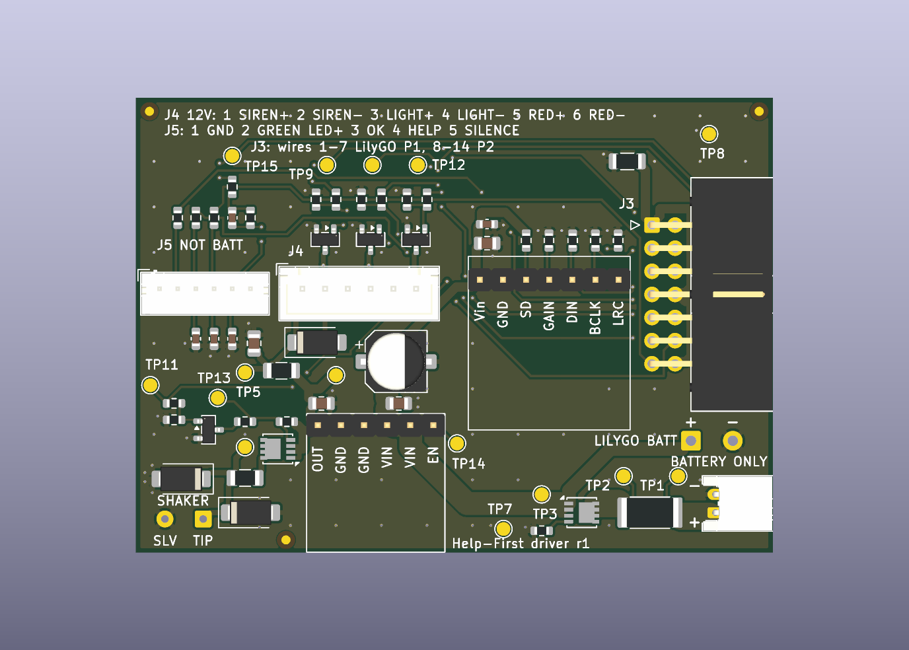

# Help-First beacon driver board (custom PCB, spin 1)

A 70 × 50 mm, 2-layer board that replaces the hand-soldered 5 × 7 cm "driver board" in the Help-First case
(`hardware/beacon-help-first/`), in the same pocket. **Status: drawn, routed and checked in KiCad 10; not ordered,
not built.** The bench units stay on perfboard with the same circuit (decision #44).

What it does, how and why: [DESIGN.md](DESIGN.md). The decisions behind it: #42–#49 in `docs/decisions.md`.



## Files
| File | What |
|---|---|
| `design.json` | **The source of truth:** every part (KiCad symbol and footprint, LCSC number, value), its pin-to-net map, and its position on the board |
| `build.py` | Turns `design.json` into the KiCad project, routes it, runs KiCad's checks and writes the JLCPCB files and pictures |
| `kigen.py`, `route.py` | Helpers: the label-style schematic writer and a small grid router (pure Python) |
| `beacon-driver.kicad_pro` / `.kicad_sch` / `.kicad_pcb` | The KiCad 10 project (generated: change `design.json` or `build.py`, not these) |
| `beacon-driver.kicad_dru` | JLCPCB-safe design rules (0.2 mm clearance and track, 0.3/0.6 mm vias, 0.5 mm copper to edge) |
| `beacon.pretty/` | Two project footprints: the Pololu U3V40F12 and the Adafruit MAX98357A breakout on their headers, with each module board's outline as the courtyard |
| `beacon-driver-schematic.pdf` | The schematic, for review |
| `beacon-driver-assembly.pdf` | Assembly drawing: every part's reference and outline (for checking JLCPCB's placement preview and naming the test points with no room on the silkscreen) |
| `jlcpcb/beacon-driver-gerbers.zip` | Gerbers + drill files to upload to JLCPCB |
| `jlcpcb/beacon-driver-bom.csv`, `jlcpcb/beacon-driver-cpl.csv` | Parts list and placement file for JLCPCB assembly (48 parts on the top side) |
| `pictures/board-top.png`, `board-bottom.png` | Renders |

## Checks (2026-11-27, KiCad 10.0.8)
- **ERC** (schematic electrical rules): 0 violations.
- **DRC** (layout rules, with schematic parity and zones refilled): 0 errors, 0 warnings, 0 unconnected pads, 0
  schematic-parity issues. Text is at least 1.0 mm high with a 0.16 mm stroke (JLCPCB's minimums).
- **Drill check:** `build.py` confirms all 192 plated holes in the drill file land on a copper pad or via in the
  Gerbers (an earlier version had the drill file on a different origin; the review caught it). Silk near the board edge is the only check turned off: the connectors overhang the right edge
  on purpose, and JLCPCB clips silk there.
- **Fit in the case:** `hardware/beacon-help-first/make_case.py` models the board, its 15 mm part height (13 mm in the
  top 17 mm strip, behind the siren holder), the battery plug and the ribbon socket on the right edge, and passes.
- **Not checked by software:** how the board behaves. That's the bench tests in DESIGN.md, run on the perfboard units
  **before ordering**.

## Rebuilding
KiCad 10.0.x must be available (its normal install needs your Mac password: `brew install --cask kicad`). Then:
```
KICAD_APP=/Applications/KiCad/KiCad.app \
  /Applications/KiCad/KiCad.app/Contents/Frameworks/Python.framework/Versions/Current/bin/python3 \
  hardware/beacon-driver-pcb/build.py
```
It prints the ERC and DRC results and exits non-zero if either finds a problem. To look at or edit the board by hand,
open `beacon-driver.kicad_pro` in KiCad (hand edits are overwritten by the next `build.py` run).

## What you need with this board (per beacon; checked 2026-11-27)
JLCPCB fits all the small parts and the four connectors. Everything else plugs in or solders on by hand. No crimping
tool is needed: the two harnesses come pre-assembled.

| Goes into | What to buy | Price | Per beacon | For 5 | Notes |
|---|---|---|---|---|---|
| **U1** | Pololu [U3V40F12](https://www.pololu.com/product/4016) 12 V booster (#42) | $9.95, $9.15 each for 5 | 1 | 5 | Header strip included. Solder it **flat** on its straight header, parts up, matching the silk (OUT GND GND VIN VIN EN). Pololu showed "backorders allowed" with no count: check stock |
| **U2** | Adafruit [3006](https://www.adafruit.com/product/3006) MAX98357A amplifier | $5.95 | 1 | 5 | Header included; the speaker terminal comes soldered on. Break the header to 7 pins. **Screw the speaker wires in before soldering U2 down** |
| U2's terminal | The speaker you already have (Adafruit [3351](https://www.adafruit.com/product/3351)) | (on the list) | 1 | 5 | Cut off its JST plug (so it can never go into J1 or the LilyGO's SOLAR socket), shorten to about 150 mm, screw in |
| **J1** | The battery (Adafruit [5035](https://www.adafruit.com/product/5035)) plugs straight in | (on the list) | 1 | 5 | Keyed. **First time only:** Hold a bare JST S2B-PH-K-S as it sits on a board (its PCB pins pointing down, the opening facing you), plug the pack in and meter the two pins underneath: the LEFT pin is pin 1 and must read + (3.6–4.2 V). If it reads −, stop and don't plug that pack into a beacon |
| **J2** | 22 AWG stranded wire, red + black: SparkFun [PRT-08865](https://www.sparkfun.com/products/8865) and [PRT-08867](https://www.sparkfun.com/products/8867) (25 ft each) | $5.95 each | ≈ 150 mm each | 1 spool each | Red from J2 "+" to the LilyGO 18650 holder's + tab (ESP32 end), black from "−" to its − tab (antenna end). Solder the holder end before the LilyGO goes on its posts |
| **J3** | A 14-pin (2 × 7) IDC ribbon cable, cut in half: 3M [M3AAA-1418J](https://www.digikey.com/en/products/detail/3m/M3AAA-1418J/229962), 1.5 ft | ≈ $5.60–6.38 (not confirmed) | ½ cable | 3 cables | **DigiKey stock not confirmed** (it blocked the check): look in a browser. Each half is about 220 mm. Peel the cut end once, between wires 7 and 8: wires 1–7 go to LilyGO row P1, 8–14 to row P2 (table in DESIGN.md). Hot-glue the ribbon near the LilyGO so the solder joints don't flex. **If it's out of stock:** 3M 89114-0001 IDC sockets (Master Electronics, $1.19 each, minimum 25) on 14-way 1.27 mm ribbon, pressed shut in a bench vise |
| **J4** | Adafruit [4876](https://www.adafruit.com/product/4876) 6-pin JST-XH-compatible cable pair | $1.25 | 1 (socket half) | 5 | Pre-crimped, 26 AWG, about 20 cm. Tag each wire with its pin number. Solder the far ends: 1–2 siren +/−, 3–4 light strip +/−, 5–6 red-button light +/− |
| **J5** | Adafruit [5090](https://www.adafruit.com/product/5090) 6-pin JST-PH-compatible cable pair | $0.95 | 1 (socket half) | 5 | Pre-crimped, 26 AWG. Pin 1 GND (daisy-chain to the green LED −, green switch, red switch and silence button with short black jumpers), 2 green LED +, 3 green switch, 4 red switch, 5 silence button; cut pin 6 short and insulate it |
| J5 pin 5 | Adafruit [1502](https://www.adafruit.com/product/1502) 16 mm yellow push button: the **SILENCE** button (#48) | $0.95 | 1 | 5 (+1 spare) | Normally open. Mounts on top of the case. Solder two wires: one to J5 pin 5, one to GND |
| **J6** | 26 AWG silicone wire, gray (tip) + black (sleeve): Adafruit [1884](https://www.adafruit.com/product/1884) and [1881](https://www.adafruit.com/product/1881), 2 m each | $0.95 each | ≈ 200 mm each | 1 gray + 2 black | Gray from "TIP" to the jack's tip lug, black from "SLV" to its sleeve lug. The extra black is for the J5 ground jumpers. Measure the shaker's plug first: it must be tip-positive (#47) |
| Under the board | Foam tape **no thicker than 1 mm** (Adafruit [5019](https://www.adafruit.com/product/5019) says both "1mm" and 0.063 in, so measure it) | $0.75 | 2 strips | 4 packs | Cut strips about 1.5 mm wide for the two ledges. Thicker tape pushes the board into the siren holder's space |
| Building | Lead-free solder (SparkFun [TOL-09163](https://www.sparkfun.com/products/9163)), heat-shrink (Adafruit [1649](https://www.adafruit.com/product/1649)), a flux pen and desoldering braid | $4.95 each | | | Tools: soldering iron, flush cutters (trim every lead under the board to 2 mm or less), wire stripper, multimeter, small screwdriver, heat gun |

**Add-on cost per beacon:** about $22 (the two modules $15.10, cables and wire about $5, the silence button $0.95),
plus the board itself. The modules and speaker are needed on perfboard too.

## Ordering from JLCPCB (founder steps; nothing has been ordered)
1. **Before ordering:** the perfboard bench units pass the bench tests in DESIGN.md, and an experienced engineer has
   looked over the schematic PDF and the board (`docs/BEACON_PCB.md` step 6).
2. **Account:** JLCPCB needs an account. Under 18, its terms need a parent's or guardian's permission, or an adult
   officer of the nonprofit can order. Payment is yours.
3. **Board:** upload `jlcpcb/beacon-driver-gerbers.zip`. Settings: 2 layers, 70 × 50 mm, 1.6 mm, 1 oz copper,
   lead-free HASL, quantity 5.
4. **Assembly:** turn on PCB Assembly, **Economic**, top side, 5 boards. Upload `beacon-driver-bom.csv` and
   `beacon-driver-cpl.csv`. Tick **"Confirm parts placement"**.
5. **Check the placement preview** against `beacon-driver-assembly.pdf`. KiCad and JLCPCB sometimes disagree on a
   part's rotation; fix any that look turned in JLCPCB's own tool. What correct looks like (board seen from the top,
   battery socket at the bottom right):
   - **C1** (the round can): + on the LEFT, the dark stripe (−) on the RIGHT.
   - **D2 and TVS1:** cathode band on the LEFT. **D1:** cathode band on the RIGHT.
   - **Q11** (square, bottom right): its 4 small pins on the LEFT, the big tab on the RIGHT toward R1.
   - **Q16** (square, left): small pins on the RIGHT, big tab on the LEFT toward F1.
   - **Q12, Q13, Q15** (top row): the single pin points DOWN toward the white J4 connector. **Q14:** single pin RIGHT.
   - **J1, J3, J4 and J5 are listed at their pin 1, not their middle,** so the preview may draw them shifted by up to
     about 9 mm: drag each one onto its holes.
   - **J1** opening facing the RIGHT edge; **J3**'s shroud at the right edge, opening facing right; **J4/J5** with pin 1
     at the LEFT end, as on the assembly drawing.
6. **Parts JLCPCB doesn't fit:** U1 (Pololu U3V40F12), U2 (Adafruit 3006), the J2 and J6 wires, and the cables. See the
   list below.
7. **Checkout:** choose DDP, so the US import duty (about 35%) is paid up front.

Cost estimate (not a quote): about $64 for 5 assembled boards before duty and shipping, about $100–117 delivered; see
DESIGN.md.
