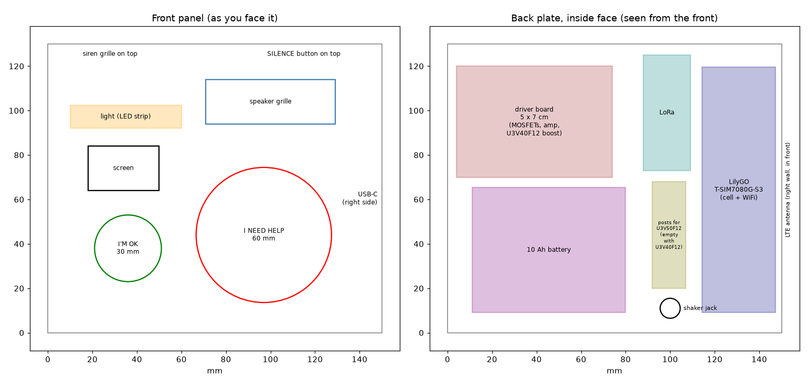
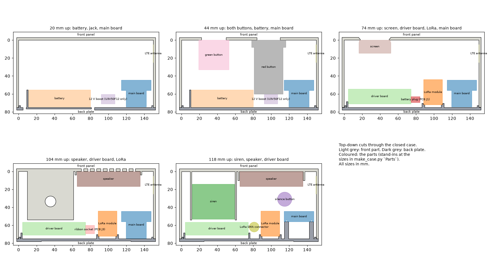

# Help-First Home Beacon case (bench prototype)

Two printed parts held together by 4 M3 screws. **Status: designed and fit-checked in software only. Not printed.** The
version and why are in [`docs/BEACON_RECOMMENDATION.md`](../../docs/BEACON_RECOMMENDATION.md) (decision #39). The parts
are in [`docs/HOME_BEACON_HELP_FIRST_BUY.md`](../../docs/HOME_BEACON_HELP_FIRST_BUY.md). The earlier, smaller case for
the WiFi-plus-LoRa design is in `hardware/beacon/`.





| File | What | Print orientation |
|---|---|---|
| `stl/front.stl` | Front panel and walls. **Front:** screen window, speaker grille, light window, 30 mm green and 60 mm red button holes, label recesses. **Top:** siren grille, the LoRa antenna's SMA hole, and the SILENCE button's 16 mm D-shaped hole (#48) with a 0.6 mm sticker recess in front of it. **Right side:** USB-C opening, and inside it a frame for the stick-on LTE antenna in front of the main board. **Inside:** screen posts, speaker frame, siren holder (with a wire slot on each side, open at the back, and a front stop) | Front panel flat on the bed (already oriented). No supports |
| `stl/back.stl` | Back plate. **Battery:** cradle with a strap. **Boards:** 4 screw posts for the LilyGO board; pockets for the LoRa module and the 70 × 50 mm driver board (perfboard or the driver PCB in `hardware/beacon-driver-pcb/`), with end stops and rails that rise 1 mm above a board on 1 mm foam tape. **Also:** posts for a U3V50F12 boost (empty with the U3V40F12, #42), and the bed-shaker jack hole (plate thinned to 2 mm there). **Outside:** a 0.6 mm recess for the safety label | Outer face flat on the bed (already oriented). No supports; the label recess's floor prints as a 30 mm bridge, so it may sag a little (the label covers it) |

**Size:** 155 wide × 81 deep × 135 tall mm, about the size of a small bedside speaker. It stands on a nightstand. There
are no wall keyholes, because the driver board covers that part of the back.

## Printing
- **Material:** PETG or PLA, in **white** so the alarm light shows through the 0.8 mm skin over the LED strip.
- **Settings:** 0.2 mm layers, 3 walls, 20% infill.
- **Plastic:** about 250 cm³ of solid volume. At these settings that's about 250–270 g (front about 200 g, back about
  60 g). Check your slicer's figure, and have at least 250 g on the spool before starting the front.
- **Time:** the front takes several hours (roughly 3–8 h, depending on the printer); the back about 1–2.5 h.
- **Bed:** each part is about 155 × 135 mm, so it needs a bed at least 160 mm square with the brim off (180 mm or more
  is comfortable). PLA and PETG don't need a brim on a face this big.
- **Checked (2026-11-27):** both STLs are single closed solids with no bad edges, sit flat on the bed, and need no
  supports. The only overhangs are short bridges: the label recesses (the back's is 30 mm), a 16 mm bridge over the
  USB-C opening, the back grooves and the screw counterbores.
- **Screws (self-tapping):**
  - **Case:** 4 × M3 × 10 mm.
  - **LilyGO board:** 4 × M1.7 × 5–6 mm. Its holes are exactly 2.0 mm, too tight for M2. Before the board goes on,
    drive each screw into its bare post once, by hand, and back it out: that cuts the thread. If one binds, open the
    hole with a 1.2–1.3 mm drill in a pin vise.
  - **Screen:** 4 × M2 × 4–5 mm.
  - **Boost** (only for a U3V50F12): 2 × M2 × 5 mm.

## Part sizes (sources)
| Part | Size used | Source |
|---|---|---|
| LilyGO T-SIM7080G-S3 (with PMU) | 110.5 × 32.9 mm; holes Ø2.0 on 27.7 × 105.6 mm. USB-C on the long edge that's on your left with the antenna end down (parts side up), 59.2 mm from that end, sticking out ~1.9 mm. LTE socket ~14 mm from the antenna end, same edge. ~20 mm thick with the 18650 holder. Mounted antenna end **up**, so the USB-C edge faces the right wall | Maker DXF and README ([GitHub](https://github.com/Xinyuan-LilyGO/LilyGo-T-SIM7080G)); thickness from CNX. **Measure the holder height** (`lily_back_h`, 18.5 assumed) |
| LTE antenna (in the LilyGO box) | 110.5 × 19.9 mm flexible, stick-on; 126 mm lead leaving ~18 mm from one end | LilyGO antenna sheet (XY03-NB). **Measure** |
| Waveshare Pico-LoRa-SX1262-915M | 21 × 52 mm; 28 mm allowed for headers and jumper plugs | [Waveshare wiki](https://www.waveshare.com/wiki/Pico-LoRa-SX1262). **Measure the height** |
| Adafruit 5035 battery | Max 69.0 × 56.5 × 19.0 mm | Maker drawing (PKCELL, p. 8) via [Adafruit](https://www.adafruit.com/product/5035) |
| 12 V square siren: Mallory PS-723BQ (the pick, decision #35); Wishiot for wiring tests only | 47 × 39 × 23.5 mm; the Mallory's leads leave a 39 mm end face at the base; its 26.3 mm round sound port is on the top face, centred 16.0 mm from the end without the leads (the grille is centred there) | Mallory datasheet 47 × 39 × 23 (rev B drawing); Wishiot listing. **Measure** |
| Pololu U3V50F12 (only for a shaker over about 0.2 A; the U3V40F12 pick sits flat on the driver board) | 48 × 15 × 10.5 mm; M2 holes ~43.2 × 10.2 mm apart, top-left and bottom-right when stood upright with parts forward | [Pololu 2568](https://www.pololu.com/product/2568) |
| Driver board (5 × 7 cm perfboard, later the driver PCB, #44) | 70 × 50 mm, parts up to 15 mm; under 13 mm in the top 17 mm strip (behind the siren holder) | Adafruit 4786 / ELEGOO kit |
| Speaker 3 W 4 Ω | 70.2 × 31 × 16.6 mm; the frame is 71.2 × 32 mm inside, with lead notches in both ends | Adafruit 3351 drawing; CQRobot listing |
| 1.3-inch OLED: ProtoSupplies DSP-9 (the pick, #43) | Board 35.40 × 33.50 mm; holes 3.0 mm on 30.40 × 28.50 mm; glass 23.00 mm tall, centred; lit area 29.42 × 14.70 mm, centred 2.05 mm toward the header. The window is 32 × 20 mm, so every row shows whichever way up the screen goes | ProtoSupplies dimension drawing (also fits the Adafruit 938 and the Hosyond). **Measure the glass thickness** |
| Red 60 mm button | 26 mm hole; 60.8 mm bezel; ~38 mm collar, then ~32 mm body to 60 mm deep with wires | [Adafruit 1190](https://www.adafruit.com/product/1190) drawing and guide. **Measure** |
| Green 30 mm button | 30 mm hole; nut ~35 mm across; ~30 mm deep | Adafruit 3487 drawing |
| 3.5 mm panel jack | M6 thread, ~2.5 mm max panel; body 12.5 mm deep, lugs up to 11.4 mm wide | Adafruit 4361 (Kaweei PJ-314M-1) drawing |

## What the fit checks cover
`make_case.py` places a stand-in ("ghost") for every part and checks for overlaps:
- **Parts:** no part collides with the case or with any other part. That includes the USB-C receptacle sticking out of
  the board's edge and the plug in front of it.
- **Front and back:** the two printed parts don't overlap each other.
- **Battery:** the strap has a clear path around the pack, and the cradle holds the pack with 0.4 mm to spare.
- **LTE antenna:** at least 10 mm from metal (battery, boost, speaker, siren), and its 126 mm lead reaches the board's
  socket with at least 40 mm of slack to open the case. It now needs about 39 mm; from the left wall it would have
  needed about 145 mm.

A test that deliberately blocks the strap slot, or moves the red button onto the main board, makes the checks fail as
they should.

**Driver board stand-in:** 15 mm of parts, 13 mm in its top 17 mm strip (behind the siren holder), sitting on 1 mm
of foam tape, plus the driver PCB's battery plug and ribbon socket on its right edge. **Silence button:** a 22 mm nut
and a 16 mm body 22 mm deep under the top wall.

**Size-limit tests (2026-11-27):** the checks still pass with the speaker at 70.3 × 31.2 × 17.6 mm, the LilyGO's
holder at 15–20 mm and its front parts up to 14 mm, the siren up to 47.5 × 39.5 × 24 mm, the red button's body 34 mm
and collar 40 mm, the green nut 37 mm and 35 mm deep, the LoRa module 31 mm tall, the screen 14 mm deep with 3 mm
glass, and the jack 14 mm deep. They fail with a siren of 48.5 × 40 × 25 mm, driver-board parts over 15 mm, or a red
button deeper than 60 mm (that one only hits a U3V50F12 boost on its posts). Also checked: the siren slides in from the
back with its leads in the slot, and the screen window hides none of the lit area either way up.

**Closest gaps** (`case_sections.png`): red button to battery 1.0 mm, driver board to the LoRa antenna connector
1.2 mm, screen to green button 1.25 mm, main board to red button 1.4 mm, siren to driver board 2.4 mm.

**Assumptions to confirm on the bench:** the 18650 holder sits in the middle of the board's back, clear of the 4 mounting
holes; and the wires soldered to the board's left header row (about 1.5–4 mm right of the red button's body, from 13 to
54 mm up) can be routed past the red button's body and switch without pressing on them.

## Assembly order
1. **Measure** whatever parts you already have from the buy list's "Measure when the parts arrive", update `Parts`,
   rerun, then print. Printing before the parts arrive is fine for a first fit test: the size-limit tests above show
   the slack. Right after printing:
   - test-fit the bare back plate in the front; if it's snug, sand the lip's outer face a little;
   - test-fit the green button (trim the first-layer lip if it binds);
   - if the SMA connector binds in the top hole, run a 1/4 in drill through it by hand.
2. **Before any home use:** the box must carry the safety wording from `docs/HOME_BEACON.md` § 1: not a smoke alarm;
   does not call 911; doesn't replace official alerts or evacuation orders. Put the label in the recess on the back,
   with wording the founder approves. It also needs a reachable silence control (see the buy list's wiring plan).
3. **Main board,** before it's mounted, with its power switch OFF:
   - Insert the SIM.
   - Solder wires straight to the header holes you need (no header pins).
   - Last, solder the battery leads to the 18650 holder's tabs: + is the tab at the ESP32 end, − the one at the LTE-antenna
     end (check with a meter). Leave the holder empty: it's for one 18650 lithium cell, and AA batteries must never go in.
   - **The OFF switch doesn't make the tabs safe:** they connect before the switch, so once the pack is on, the tabs and
     everything wired to them are live.
4. **Back plate:**
   - Strap the battery into its cradle with its lead corner at the **top right**: the pack's leads are only 100 mm.
     Lay them along their route before cutting the plug (cut one wire at a time, never both together), and extend a
     lead with 22–24 AWG stranded wire and heat-shrink only if it doesn't reach.
   - Screw the LilyGO board onto its 4 posts with M1.7 screws: 18650 holder facing the plate, antenna end up, USB-C
     toward the right wall.
   - Fix the LoRa module and the driver board on their ledges with foam tape no thicker than 1 mm. With the driver
     PCB, plug the battery and the ribbon in before pressing the board down onto its tape.
   - The U3V40F12 boost is soldered flat on the driver board (#42). Only a U3V50F12 goes on the boost posts.
   - Fit the shaker jack.
5. **Front:**
   - Stick the LED strip into the light-window pocket first (leads soldered on), then mount the screen on its posts
     (glass toward the window, either way up) and the speaker in its frame, with its leads out through a notch.
   - Fit the two buttons; cut the two alignment posts off the red one first.
   - Fit the yellow **SILENCE** button (Adafruit 1502) in the top hole: line its thread's flat up with the hole's
     flat, then tighten the nut from inside. Put the "SILENCE" sticker in the recess in front of it (#48).
   - Slide the siren in from the back, leads in the **right-hand** slot (so its round sound port is on the left, under
     the grille), until it meets the front stop. Fix it with a dab of hot glue: nothing else stops it sliding back
     about 2.4 mm onto the driver board's parts.
   - Stick the LTE antenna between the rails on the right wall, lead end at the top.
6. **Wiring:**
   - Wire with the two halves opened like a book along the top (or right) edge, and leave front-panel wires about
     15 cm long; tuck the slack in when closing.
   - Follow the proposed wiring plan in the buy list, and check every connection against LilyGO's schematic.
   - Return the boost's and the amplifier's ground straight to the 18650 holder's − tab, not to the board's GND pins
     (decision #45): board GND reaches that tab only through a small transistor on the LilyGO.
   - First checks: battery polarity with a meter, and 12 V at the boost output.
   - Plug the LTE antenna into the board's LTE ("NBIOT") socket.
   - Run the first siren tests with the back plate off and ear protection on, until the firmware's silence press
     works: once the case is shut, the power switch is inside.
7. **Close up:** fit the SMA connector through the top hole and screw the antenna on. Close the case with the 4 M3
   screws.

## Regenerating
```
hardware/.venv/bin/python hardware/beacon-help-first/make_case.py --preview hardware/beacon-help-first
```
It writes `stl/front.stl` and `stl/back.stl` and prints "fit checks: OK" (or the problems). With `--preview` it also
writes `case_layout.png`, `case_overview.png` and `case_sections.png`.
